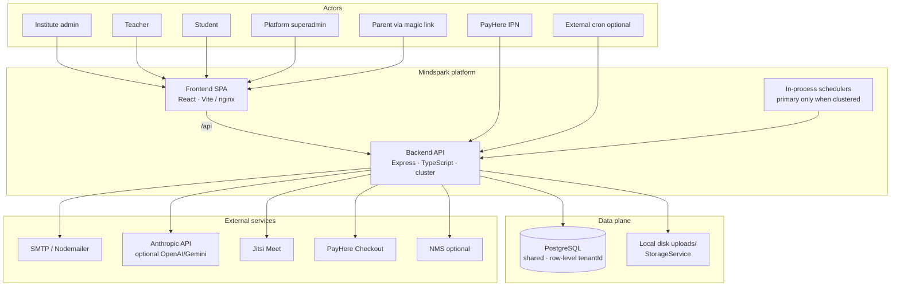
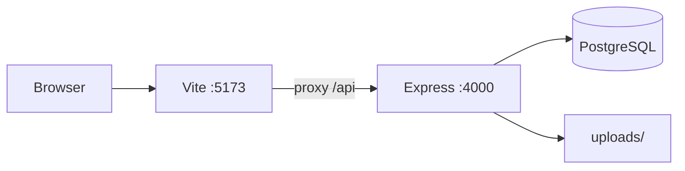
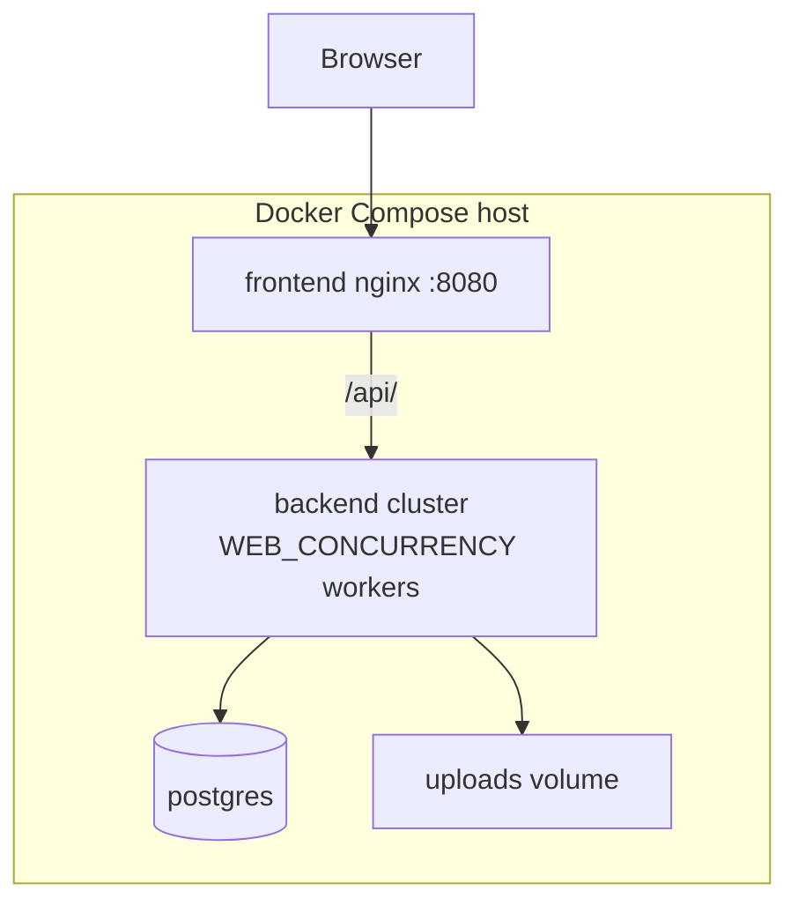
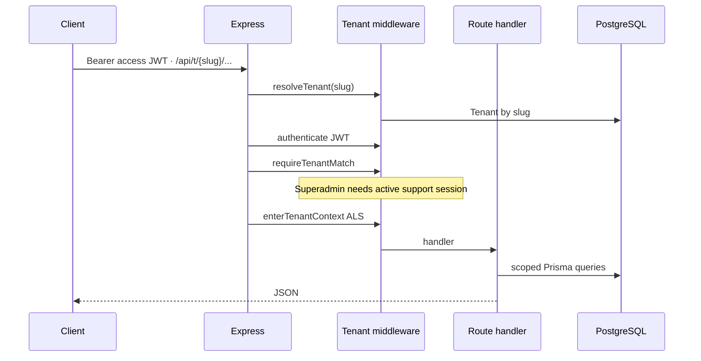
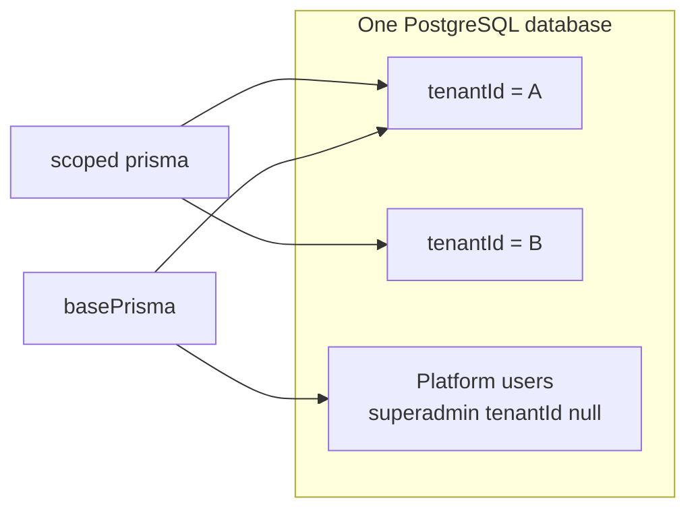
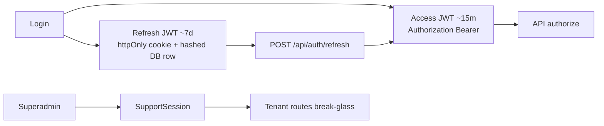
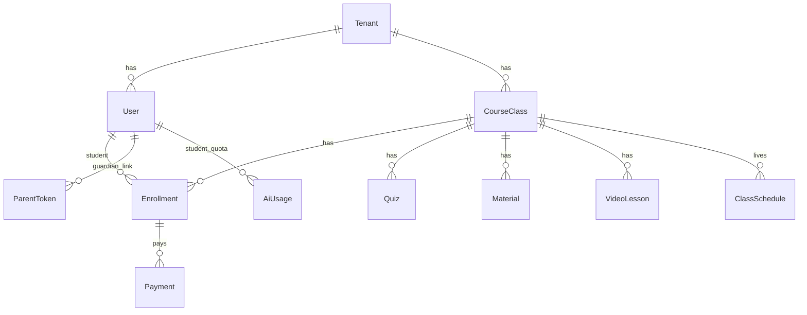
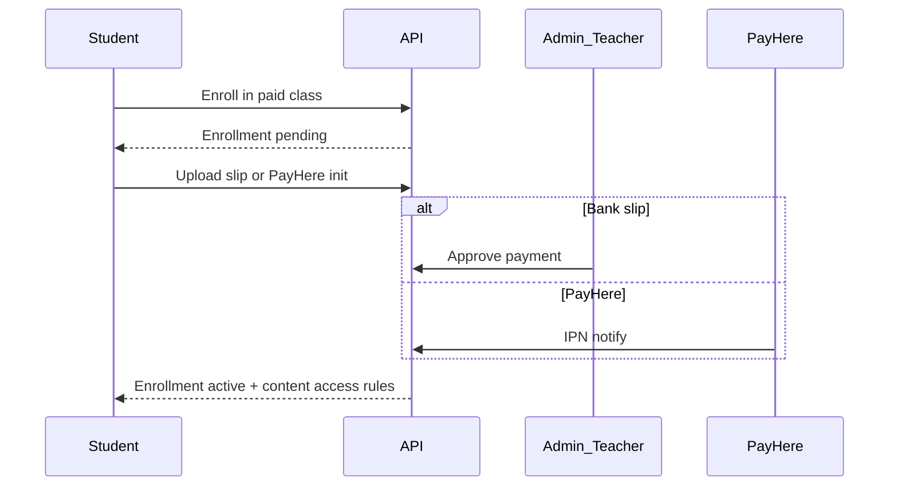
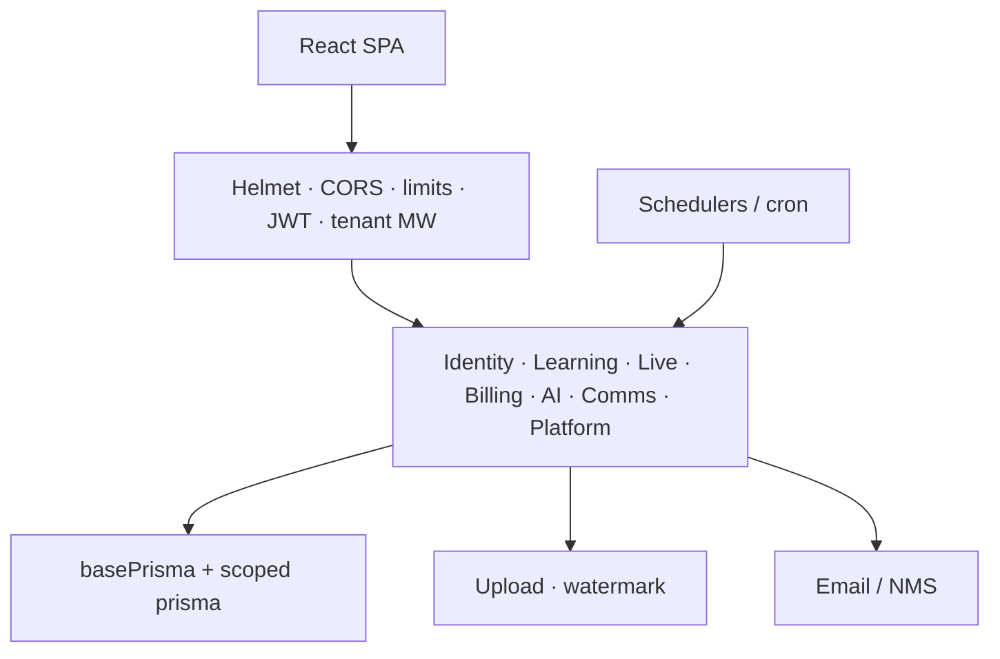

# Mindspark LMS — Architect Technical Brief

| Field | Value |
|-------|--------|
| **Audience** | Software / solution architects |
| **Status** | **As-built (shipped)** — documents the system as implemented in this repository |
| **Date** | 16 October 2026 |
| **Stack** | React + Vite · Express + TypeScript · PostgreSQL + Prisma · local disk uploads |

**Related as-built docs**

| Doc | Purpose |
|-----|---------|
| [architecture-current.md](./architecture-current.md) | High-level as-built diagrams |
| [architecture.md](./architecture.md) | Detailed monolith maps (API, tenancy, materials) |
| [design.md](./design.md) | Domain model and key product flows |
| [security-audit.md](./security-audit.md) | Security architecture audit and remediation status |
| [LOAD_PERFORMANCE_REPORT.md](./LOAD_PERFORMANCE_REPORT.md) | Measured load results (29 Sep 2026) |
| [DOCKER_SETUP.md](./DOCKER_SETUP.md) | Docker Desktop runbook |

---

## 1. Executive architecture summary

Mindspark is a **multi-tenant SaaS Learning Management System**. One shared application and one shared PostgreSQL database serve many institutes (**tenants**). Isolation is **row-level** via `tenantId`, enforced in the data access layer. Tenancy is **path-based**: browser routes `/{slug}/...`, API routes `/api/t/:slug/...`.

The shipped system is a **modular monolith**:

- One Express API process tree (optional Node **cluster** of workers)
- One React SPA
- One Postgres database
- Local disk for uploads (behind a `StorageService` interface)

### What is in this deployment

- Platform superadmin console and per-institute LMS (admin / teacher / student)
- Classes, materials (view-only watermarked rendering), quizzes, assignments, attendance, live class (Jitsi + external meeting URLs)
- Payments: bank-slip approval and optional PayHere checkout + IPN
- AI Study (students) and AI Teacher Copilot (optional Anthropic; fallbacks)
- Parent Trust Center (time-limited magic link, no parent LMS login)
- In-process schedulers (fee reminders / digests) on the cluster primary

### What is **not** in this deployment

Do not assume these as current production topology:

- Object storage (S3) — interface only; **local disk** is shipped
- Redis, message bus, or separate worker / queue services
- Notification microservice in Docker Compose (optional NMS via `NMS_BASE_URL` when configured)
- Kubernetes / multi-host HA with shared storage
- Microservices split (separate deployables per domain)

---

## 2. System context

---

## 3. Runtime and deployment

### 3.1 Local development

| Layer | Default | Source |
|-------|---------|--------|
| Frontend | `http://localhost:5173` | `frontend/` (Vite proxies `/api`) |
| Backend | `http://localhost:4000` | `backend/src/app.ts`, `index.ts` |
| Database | `DATABASE_URL` | Prisma `backend/prisma/schema.prisma` |
| Files | `UPLOAD_DIR` / `uploads/` | `backend/src/services/storage.ts` |

`npm run dev` runs a **single** API process. Capacity-oriented runs use `npm run build` + `npm run start` (or Docker) with `WEB_CONCURRENCY` &gt; 1.

### 3.2 Docker Compose (team / demo)

Services in `docker-compose.yml`:

| Service | Role |
|---------|------|
| `postgres` | Postgres 16; `max_connections=300`, `shared_buffers=128MB` |
| `backend` | API; default `WEB_CONCURRENCY=8`; uploads volume |
| `frontend` | nginx SPA on `${HOST_PORT:-8080}`; proxies `/api/` → `backend:4000` |

### 3.3 Process model (cluster)

From `backend/src/index.ts`:

- When `WEB_CONCURRENCY` &gt; 1, the **primary** forks that many workers and runs **schedulers on the primary only**.
- Each **worker** connects Prisma, listens on `0.0.0.0:PORT`, sets `keepAliveTimeout` / `headersTimeout`, and `maxConnections = MAX_CONNECTIONS_PER_WORKER`.
- Default `WEB_CONCURRENCY`: production ≈ `min(8, CPU count)`; development default is `1` unless overridden.

### 3.4 Capacity-related environment defaults

| Variable | Typical default | Role |
|----------|-----------------|------|
| `WEB_CONCURRENCY` | 8 (Compose) | Worker count |
| `PRISMA_CONNECTION_LIMIT` | 25 | Per-process Prisma pool (`connection_limit` on URL) |
| `MAX_IN_FLIGHT_PER_WORKER` | 400 | Soft reject (503) when worker saturated |
| `MAX_CONNECTIONS_PER_WORKER` | 1000 | HTTP server `maxConnections` |
| `API_RATE_LIMIT_MAX` | 60000 / min | Express rate limit on `/api` (`0` disables) |
| `AI_MAX_CONCURRENT` | 8 | Global AI call concurrency gate |
| `UV_THREADPOOL_SIZE` | 16 (Compose) | libuv pool for blocking I/O |

Production refuses weak/missing JWT and cron secrets (see security brief). No secret values are documented here.

---

## 4. API surface and request pipeline

### 4.1 Route mounts (`createApp`)

| Mount | Purpose |
|-------|---------|
| `GET /api/health` | Liveness (outside heavy limiter semantics for monitoring) |
| `/api/auth` | Shared login, refresh, logout, me |
| `/api/admin` | Platform superadmin + ops |
| `/api/cron` | Job triggers with `CRON_SECRET` |
| `/api/t/:slug/auth` | Tenant login / register |
| `/api/t/:slug/public` | Landing, parent report, PayHere notify |
| `/api/t/:slug/invites`, `admin-invites`, `join` | Invite and class join |
| `/api/t/:slug` | Authenticated tenant LMS API |

Middleware order (simplified): `trust proxy` (prod) → `helmet` → `cors` → in-flight limiter → `/api` rate limit → JSON (2 MB) → cookie parser → routes → not-found → error handler.

### 4.2 Authenticated tenant pipeline

Mounted in `backend/src/routes/tenant.ts`:

`resolveTenant` → `authenticate` → `requireTenantMatch` → `enterTenantContext` → domain routers.

---

## 5. Multi-tenancy and data isolation

| Concern | Approach |
|---------|----------|
| Routing | Path slug `/:slug` (UI) and `/api/t/:slug` (API) |
| Data isolation | Shared DB; tenant-owned rows carry `tenantId` |
| Request context | `AsyncLocalStorage` (`tenantId`, role, userId) |
| Query enforcement | Prisma client extension on scoped `prisma` (`backend/src/lib/prisma.ts`) |
| Platform / pre-tenant | Unscoped `basePrisma` for auth, tenant resolution, superadmin |
| Plans | `Tenant.plan` / `planFeatures` via `planGates.ts` (`pro` / `enterprise` feature flags) |

Scoped client behavior (summary):

- Injects `where.tenantId` on bulk/list-style reads and writes for ~35 tenant models
- Stamps `tenantId` on creates when context is present

**Important caveat:** `findUnique` and some single-record `update` / `delete` paths are **not** auto-scoped by the extension. Handlers must constrain by tenant (e.g. `findFirst({ where: { id, tenantId } })`) or equivalent. This is an intentional implementation detail architects should treat as a residual isolation risk mitigated by code review and route-level checks.

---

## 6. Authentication and authorization

### Roles

`superadmin` · `admin` · `teacher` · `student`  
Parents have **no** LMS role; they use a time-limited **ParentToken** magic link.

### Tokens

| Item | Behavior |
|------|----------|
| Access JWT | Short-lived (default ~15 m); payload includes `sub`, `role`, `email`, `name`, `tenantId` (null for superadmin) |
| Refresh JWT | Longer-lived (default ~7 d); httpOnly cookie (`path=/api/auth`); token stored **hashed** in DB; rotation on refresh |
| Frontend | Access token typically in `localStorage`; axios `withCredentials` for refresh cookie; auto-refresh on 401 |
| Secrets | Separate `JWT_ACCESS_SECRET`, `JWT_REFRESH_SECRET`, `JWT_WATCH_SECRET` (HS256); production fail-closed on weak defaults |
| Support | Superadmin access to a tenant API requires an active support session (time-boxed) |

Unified login at `/api/auth/login` disambiguates multi-institute emails; tenant-scoped login also exists under `/api/t/:slug/auth`.

---

## 7. Domain model and major capabilities

Prisma schema defines on the order of **~50 models**. Core relationships (Mermaid reserves `Class`, so the diagram uses `CourseClass` for the Prisma `Class` model):

| Area | Capabilities |
|------|----------------|
| Learning | Classes/batches, materials, videos, quizzes (MCQ, timed, auto-grade), assignments, gradebook, question bank |
| Live / ops | Schedules, Jitsi / Zoom / Meet / Teams links, attendance, chat, notices, events |
| Billing | Enrollment + monthly fees; slip upload + staff approval; PayHere; content gated by enrollment + monthly rules / grace days |
| Intelligence | At-risk signals, interventions, AI Study, AI Copilot, parent trust reports |
| Platform | Tenant provisioning, plans/feature gates, AI usage metering, audit log, monitoring |

### 7.1 Payment unlock (summary)

### 7.2 Quiz attempt (summary)

- Teacher creates/publishes quiz; student starts attempt (one attempt per student typically)
- Questions returned without correct answers; submit grades server-side with optional time-limit enforcement
- Results available after submit

---

## 8. Integrations

| System | Direction | Purpose | Notes |
|--------|-----------|---------|--------|
| PostgreSQL | Out | Primary store | Shared DB, row tenancy |
| Local disk | Out | Slips, materials, videos, logos | Outside static web root; streamed via API |
| SMTP / Nodemailer | Out | Invites, digests, alerts | Optional; may log when unset |
| NMS | Out | Email dispatch when configured | `NMS_BASE_URL` + JWT; not a Compose service by default |
| Anthropic | Out | AI Study / Copilot | Concurrency-limited; monthly quotas |
| OpenAI / Gemini | Out | Teacher AI fallbacks | Optional keys |
| PayHere | Out + In (IPN) | Online fees | Merchant credentials on tenant; sandbox flag |
| Jitsi | Out (embed / JWT) | Live classrooms | `JITSI_HOST`, app id/secret in production |

**Storage:** `LocalStorageService` is the shipped implementation. Callers use a storage interface so an S3 backend could be swapped later; that backend is **not** implemented in this codebase.

**Materials protection:** PDFs/images are rendered server-side into watermarked page images for enrolled viewers. Original files are not exposed as direct public URLs. Browser-based viewing remains a **deterrent**, not absolute screenshot/download prevention.

---

## 9. Cross-cutting concerns

| Concern | Implementation |
|---------|----------------|
| HTTP security headers | `helmet` |
| CORS | `CLIENT_URL`, credentials enabled |
| Rate limiting | `express-rate-limit` on `/api`; tighter auth limits |
| Saturation | Per-worker in-flight limiter → 503 + `Retry-After` |
| AI load | `AI_MAX_CONCURRENT` gate |
| Uploads | Multer; `MAX_UPLOAD_MB` / `MAX_VIDEO_UPLOAD_MB` |
| Validation | Zod (and route-level checks) on API inputs |
| Plan gates | Feature flags: AI student/teacher, parent trust, interventions, smart jobs; student caps on Pro |
| Errors | Central `errorHandler`; Prisma error mapping helpers |

Logical module layout (one process):

---

## 10. Capacity and known limits

Source: [LOAD_PERFORMANCE_REPORT.md](./LOAD_PERFORMANCE_REPORT.md) (closed-loop ramps, tenant `ictpasidu`, **29 Sep 2026**, laptop-local stack).

| Metric | Result |
|--------|--------|
| Peak read throughput | ~**170 rps** (1 process, 10 VU) |
| Read p95 at 50 VU | **10.8 s** (1 process) vs **3.4 s** (4 workers) |
| Writes at 100 VU | Usable, **0 timeouts** (mix of OK / business 409 / AI unavailable) |
| 3,000 concurrent writers | Effectively fails (timeouts) on measured 4-worker laptop setup |
| Designed Compose target | 8 workers × 1,000 connections — **not re-measured** in that report |

**Operational guidance**

- Prefer clustered start (`WEB_CONCURRENCY` ≥ 4) for concurrent class usage; single-process `dev` will stall under burst.
- Keep Postgres `max_connections` above `PRISMA_CONNECTION_LIMIT × workers` (Compose uses 300 with limit 25 × 8 = 200).
- Treat AI and heavy PDF/render paths as CPU-bound work sharing the same workers.

---

## 11. Security posture (architect summary)

Full evidence and finding IDs: [security-audit.md](./security-audit.md) (audit dated 1 August 2026; critical/high code findings remediated in-repo).

| Control | Status (as designed) |
|---------|----------------------|
| Tenant isolation | ALS + Prisma scoping + tenant match middleware |
| Passwords | bcrypt hashes |
| Sessions | Short access JWT + rotating hashed refresh; support session for break-glass |
| Payments | Slip approval workflow; PayHere signature / underpayment checks (remediated) |
| Uploads / SSRF | Size limits; video proxy allowlisting (remediated) |
| Parent links | Hashed, single-use / time-limited tokens (remediated) |
| Platform hardening | Helmet, rate limits, production secret fail-closed |
| Content | Watermarked view-only materials |
| Observability of abuse | Platform audit log; AI usage metering |

**Residual risks architects should plan for**

- Access JWT in `localStorage` (XSS impact surface); refresh is httpOnly
- Isolation depends on correct use of scoped queries for non-auto-scoped Prisma ops
- Multi-instance HA blocked by local disk and primary-only in-process cron without leader election / shared object store
- Production still needs strong secrets, live PayHere/Jitsi config, and operational controls (WAF, MFA, SCA) outside the app code

---

## 12. Strengths, risks, and scaling constraints

**Strengths**

- Clear modular domains inside one deployable API — fast to reason about and ship
- Strong tenancy and role gates concentrated in middleware + Prisma extension
- Clustering and in-flight limits improve concurrent read resilience vs single process
- Feature modules (payments, AI, live, parent trust) already isolated as routes/services

**Risks / constraints**

- **Vertical / single-host scaling:** workers share one machine’s CPU for uploads, AI, and PDF rendering
- **Local disk:** does not survive multi-instance or serverless without shared storage
- **Schedulers:** run on cluster primary only; multi-replica deploys need an external cron or leader lock to avoid duplicate jobs
- **Blast radius:** a severe bug in one domain can affect the whole API process
- **Database:** shared schema; connection pool math must be sized with worker count

---

## Appendix — Key source map

| Concern | Path |
|---------|------|
| HTTP app factory | `backend/src/app.ts` |
| Cluster / listen / schedulers | `backend/src/index.ts` |
| Env / capacity knobs | `backend/src/config/env.ts` |
| Scoped + base Prisma | `backend/src/lib/prisma.ts` |
| Tenant ALS | `backend/src/lib/tenantContext.ts` |
| Tenant middleware | `backend/src/middleware/tenant.ts` |
| Auth middleware | `backend/src/middleware/auth.ts` |
| JWT helpers | `backend/src/lib/jwt.ts` |
| Auth service / cookies | `backend/src/services/auth.ts`, `backend/src/utils/authCookies.ts` |
| Tenant router | `backend/src/routes/tenant.ts` |
| Plan gates | `backend/src/services/planGates.ts` |
| Storage | `backend/src/services/storage.ts` |
| AI Anthropic + concurrency | `backend/src/services/anthropic.ts`, `backend/src/lib/aiConcurrency.ts` |
| Schema | `backend/prisma/schema.prisma` |
| Compose | `docker-compose.yml` |
| Frontend routing | `frontend/src/App.tsx` |
| API client | `frontend/src/api/client.ts` |
| nginx | `frontend/nginx.conf` |
| Load scripts | `scripts/load-test.mjs`, `scripts/write-load-test.mjs` |

---

*End of as-built architect brief.*
