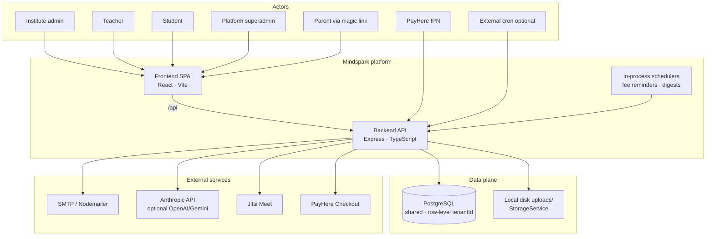
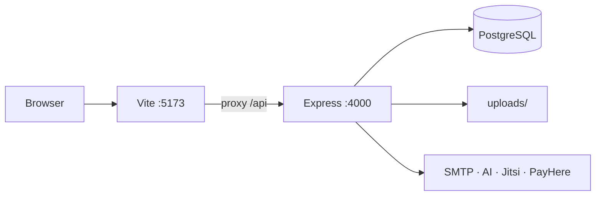
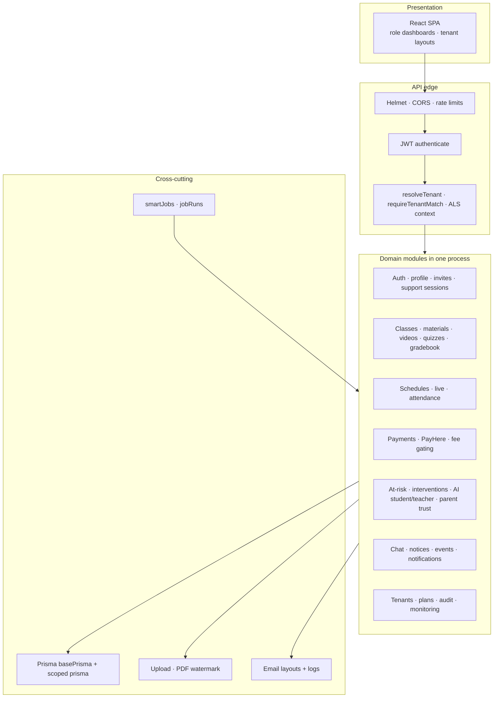
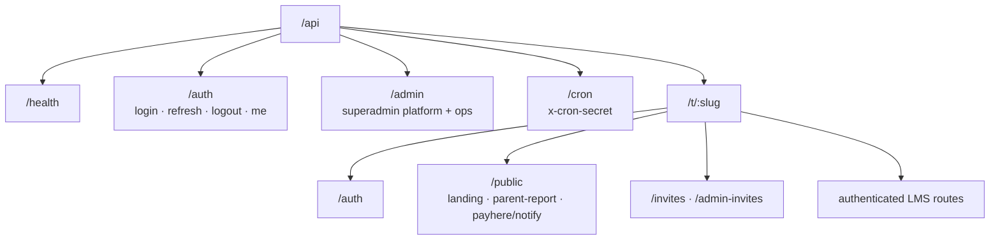
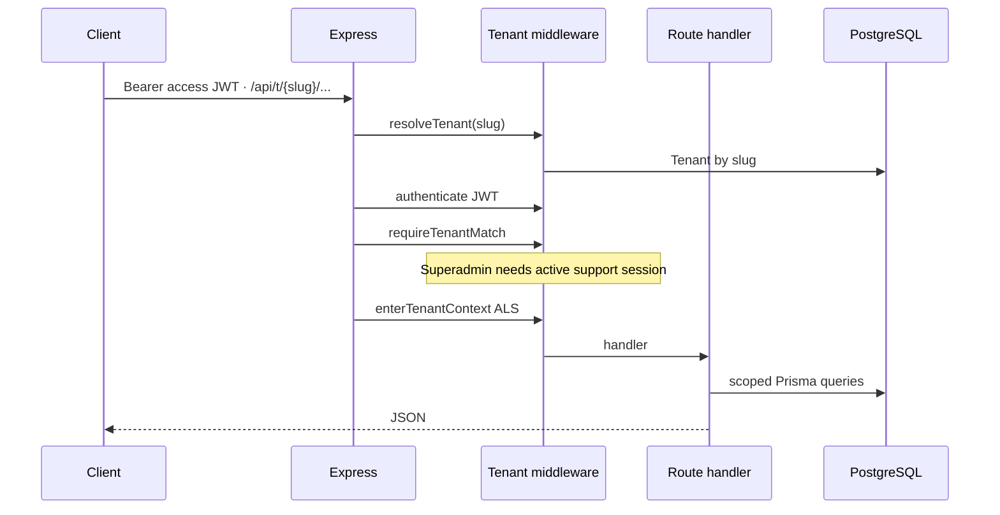
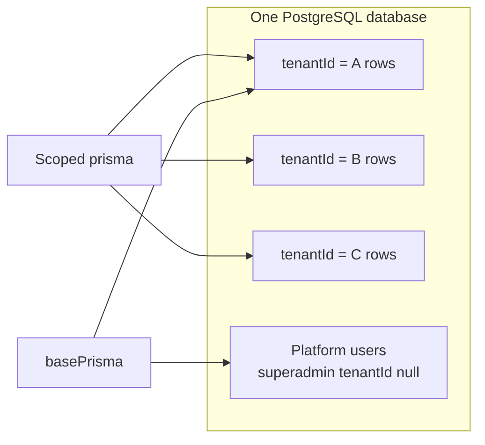
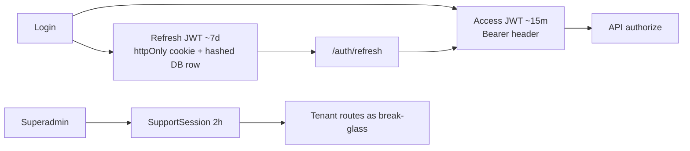
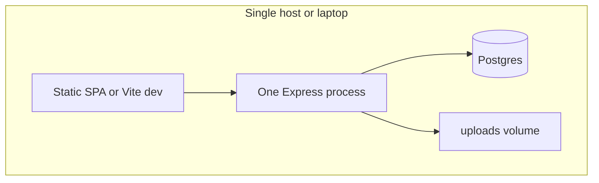

# Mindspark LMS — Current System Architecture (High Level)

**Status:** As-built (monolith)  
**Stack:** React + Vite · Express + TypeScript · PostgreSQL + Prisma · local disk uploads  
**Related:** [architecture.md](./architecture.md) (detailed), [security-audit.md](./security-audit.md), [design.md](./design.md)

---

## 1. System context

Mindspark is a **multi-tenant SaaS LMS**. One shared application and database serve many institutes (tenants), isolated by `tenantId`. Path-based tenancy uses `/{slug}/...` in the browser and `/api/t/:slug/...` on the API.



---

## 2. Runtime topology (development)



| Layer | Default | Source |
|-------|---------|--------|
| Frontend | `http://localhost:5173` | `frontend/` |
| Backend | `http://localhost:4000` | `backend/src/app.ts` → `index.ts` |
| Database | `DATABASE_URL` | Prisma `backend/prisma/schema.prisma` |
| Files | `UPLOAD_DIR` / `uploads/` | `backend/src/services/storage.ts` |

---

## 3. Logical building blocks



---

## 4. API surface (high level)



**Tenant authenticated pipeline**



---

## 5. Multi-tenancy model

| Concern | Approach |
|---------|----------|
| Routing | Path slug `/:slug` (UI) and `/api/t/:slug` (API) |
| Data isolation | Shared DB; almost all rows carry `tenantId` |
| Query enforcement | AsyncLocalStorage + Prisma extension (`backend/src/lib/prisma.ts`) |
| Cross-tenant ops | Superadmin platform routes + time-boxed **support sessions** |
| Plans | `Tenant.plan` / `planFeatures` via `planGates.ts` |



---

## 6. Auth & sessions (summary)



Roles: `superadmin` · `admin` · `teacher` · `student`

---

## 7. Core domain map

```mermaid
erDiagram
  Tenant ||--o{ User : has
  Tenant ||--o{ Class : has
  Class ||--o{ Enrollment : has
  User ||--o{ Enrollment : student
  Enrollment ||--o{ Payment : pays
  Class ||--o{ Quiz : has
  Class ||--o{ Material : has
  Class ||--o{ VideoLesson : has
  Class ||--o{ ClassSchedule : lives
  User ||--o{ ParentToken : guardian_link
  User ||--o{ AiUsage : student_quota
  User ||--o{ AiStaffUsage : teacher_quota
```

**Major areas:** learning content, assessments, live class + attendance, payments (slip + PayHere), messaging, AI copilots, parent trust reports, platform ops.

---

## 8. Frontend structure (high level)

| Area | Path pattern | Guarding |
|------|----------------|----------|
| Platform login | `/login` | Public |
| Superadmin console | `/admin/*` | `ProtectedAdmin` |
| Tenant landing | `/:slug` | Public |
| Institute app | `/:slug/dashboard`, classes, … | `ProtectedTenant` + role routes |
| Parent report | `/:slug/parent?token=` | Magic link |

Layouts: `AdminLayout`, `TenantLayout`. API helper: `useTenantApi` → `/api/t/:slug/...`.

---

## 9. Integrations

| System | Direction | Purpose |
|--------|-----------|---------|
| PostgreSQL | Out | Primary store |
| Local disk | Out | Slips, materials, videos, logos |
| SMTP | Out | Invites, digests, live alerts |
| Anthropic | Out | AI Student Area + Teacher Copilot |
| PayHere | Out + In (IPN) | Online fees |
| Jitsi | Out (embed) | Live classrooms |
| Cron secret HTTP | In | Trigger jobs if external scheduler used |

---

## 10. Deployment shape (current)

**Today:** single Node process + Postgres + local disk (typical local/dev or one VM).



This is a **modular monolith**: clear domain folders and route mounts, one deployable API. It is **not** microservices yet.

---

## 11. Strengths and limits of the current design

**Strengths**

- Fast to ship and reason about (one API, one schema)
- Strong tenancy hooks and role gates in one place
- Feature modules (AI, live, payments) already separated as services/routes

**Limits for large production**

- Vertical scaling only (one Node process shares CPU for uploads, AI, PDF, video proxy)
- Local disk does not survive multi-instance or serverless well
- In-process cron duplicates on multi-replica without a leader lock
- Blast radius: a bug in one domain can take down the whole API

For a target **production-grade microservices** design, see [architecture-microservices.md](./architecture-microservices.md).
