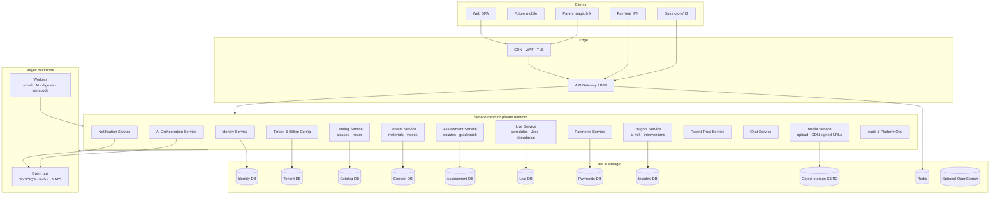
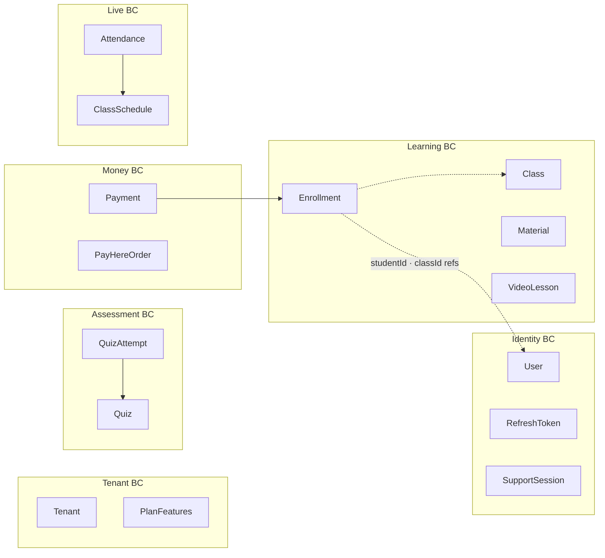
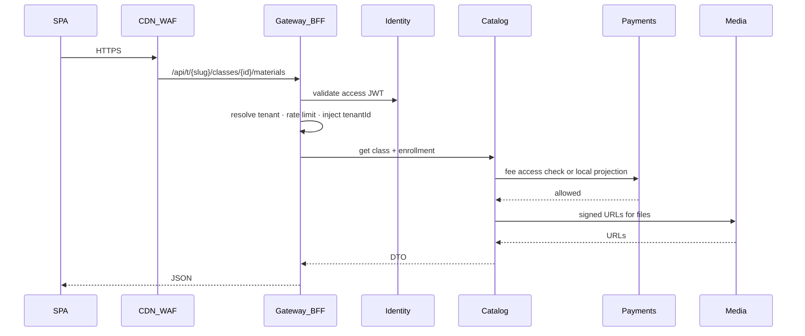
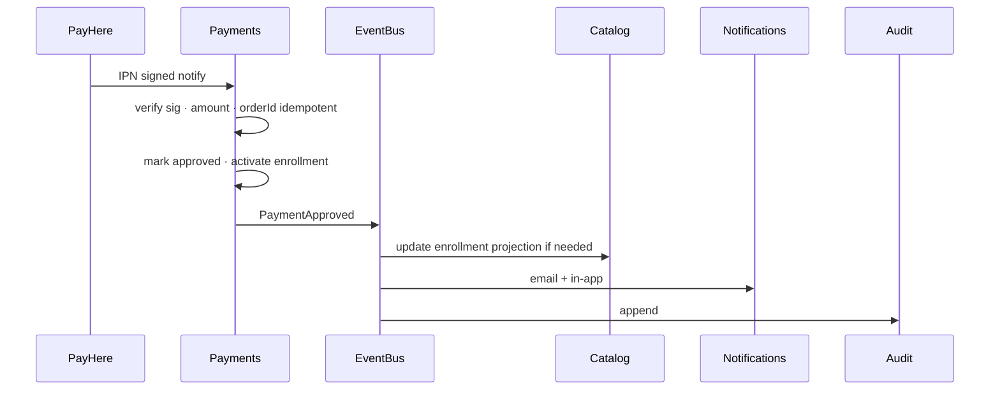
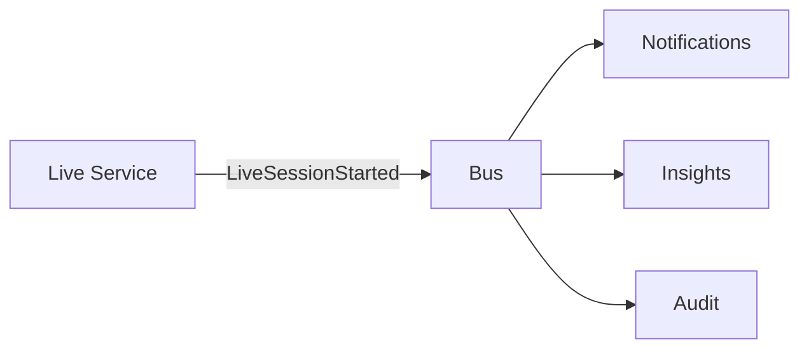
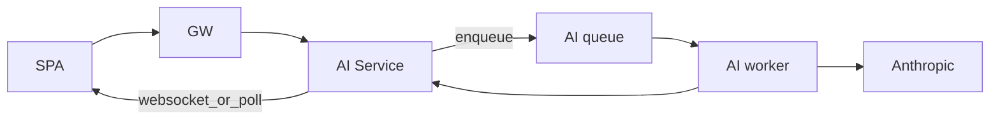
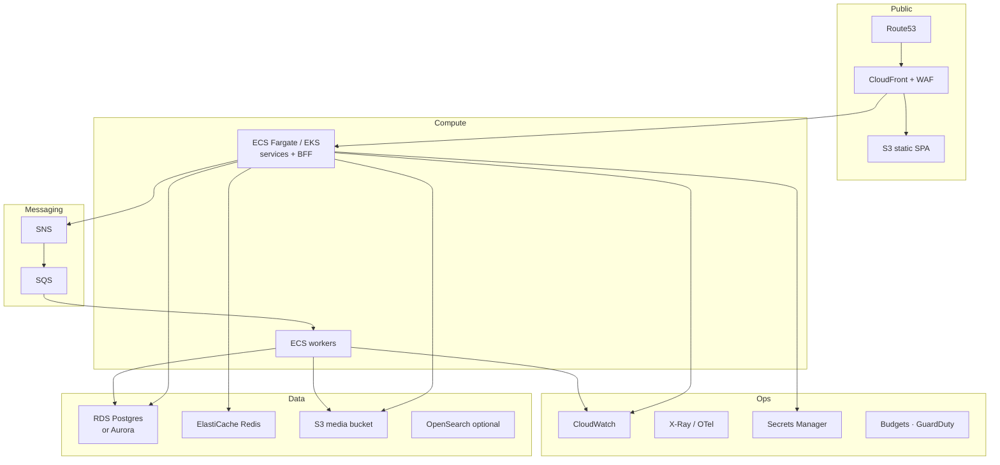
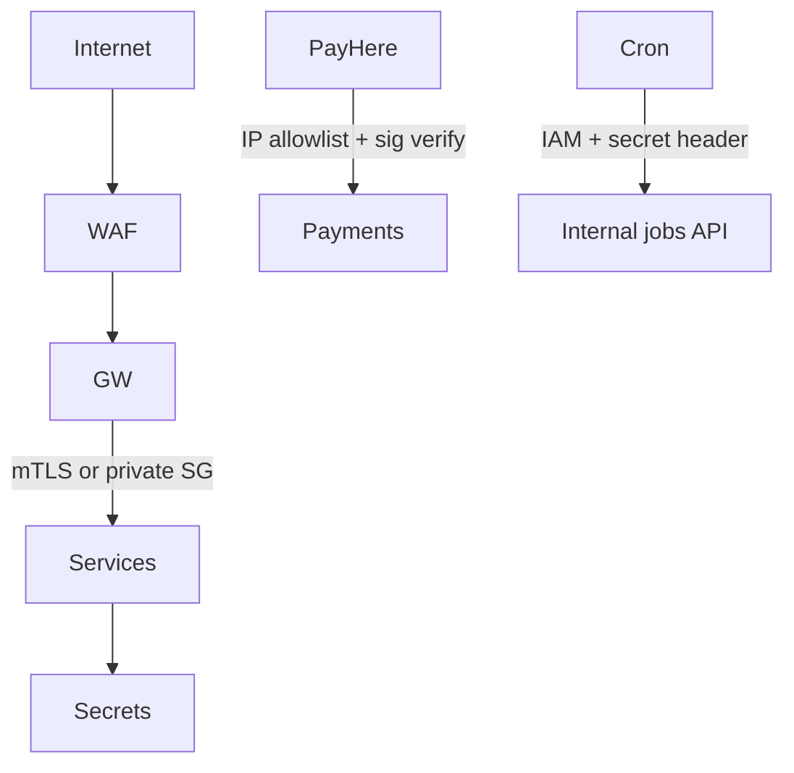
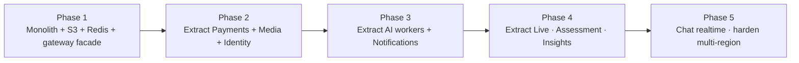

# Mindspark LMS — Production-Grade Microservices Architecture

**Status:** Target architecture (not yet implemented)  
**Baseline today:** Modular monolith — see [architecture-current.md](./architecture-current.md)  
**Goal:** Independently scalable, secure, operable multi-tenant LMS for many institutes, payments, live class, AI, and large media.

---

## 1. Design principles

1. **Split by business capability**, not by technical layer alone (avoid “user-service + class-service” chatty meshes without clear ownership).
2. **Keep a thin BFF / API gateway** for the SPA so the browser does not talk to 15 origins.
3. **Shared-nothing data where possible**; shared Postgres only when strong consistency + joins demand it — prefer **schema-per-service** or **database-per-service** with async integration.
4. **Tenant context everywhere:** every request carries `tenantId` (JWT claim + gateway injection); every store filters by tenant.
5. **Async for slow / bursty work:** AI, email, video transcode, digests, webhooks retries.
6. **Idempotent payments & webhooks** (PayHere IPN, enrollment activation).
7. **Observability first:** structured logs, traces, metrics, audit trail before “more services.”
8. **Migrate strangler-fig style** from the current Express monolith — do not big-bang rewrite.

---

## 2. Target system context

---

## 3. Service catalog

| Service | Owns | Key APIs / events | Scale driver |
|---------|------|-------------------|--------------|
| **Identity** | Users, passwords, refresh tokens, roles, support sessions | Login, refresh, MFA later | Auth spikes |
| **Tenant & Config** | Institutes, plans, feature flags, bank/PayHere merchant config | CRUD tenant, plan gates | Low QPS, high criticality |
| **Catalog** | Batches, classes, enrollments, roster | Class hub, enroll, invite accept | Core read/write |
| **Content** | Materials metadata, topics, video lessons metadata | List/stream authorize | Read-heavy |
| **Media** | Binary upload, virus scan, watermark jobs, signed URLs | Presigned PUT/GET | Bandwidth / CPU |
| **Assessment** | Quizzes, attempts, answers, gradebook aggregates | Take quiz, grade | Exam-time spikes |
| **Live** | Schedules, session status, attendance, Jitsi tokens | Start/join/end live | Concurrent sessions |
| **Payments** | Payments, slips metadata, PayHere orders/IPN, fee status | Init checkout, review, IPN | Money path — highest care |
| **Notifications** | In-app + email/SMS fan-out | Prefer inbox; consume events | Burst after live/payment |
| **AI Orchestration** | Quotas, prompt assembly, provider calls, history | Student/teacher AI tools | Cost + latency |
| **Insights** | At-risk scores, interventions, weak topics rollups | Panels, nudges | Batch + query |
| **Parent Trust** | Magic links, parent report aggregation | Send link, resolve token | Low QPS, sensitive PII |
| **Chat** | Conversations, messages | Realtime WS or SSE | Concurrent connections |
| **Audit / Platform Ops** | Audit log, job runs, cross-tenant monitoring | Superadmin console APIs | Compliance |
| **BFF / Gateway** | Composition, authn, rate limit, tenant resolve | `/api/*` for SPA | All traffic |

---

## 4. Bounded contexts & data ownership

**Rules**

- No service updates another service’s tables.
- Cross-context reads via **APIs** or **read models** fed by events (e.g. Insights listens to `QuizAttemptSubmitted`, `AttendanceMarked`, `PaymentApproved`).
- Payments is the **source of truth** for fee status; Catalog/Content call Payments (or cache projection) for gating.

---

## 5. Request path (SPA → services)

**Gateway responsibilities**

- TLS termination (or trust CDN)
- JWT validation (or introspect Identity)
- Tenant slug → `tenantId`
- Superadmin support-session enforcement
- Per-route rate limits (auth, AI, upload, IPN)
- Request ID / trace propagation
- Optional BFF aggregation for dashboards (parallel fan-out)

---

## 6. Event-driven flows

### 6.1 Payment approved → unlock content

### 6.2 Live class started

### 6.3 AI job (async preferred at scale)

Synchronous AI can remain for small quotas; production should bound concurrency and isolate spend.

---

## 7. Infrastructure (AWS-oriented complete picture)

Aligned with the AWS hosting direction; adaptable to any cloud.

| Concern | Production choice |
|---------|-------------------|
| Compute | ECS Fargate (simpler) or EKS (mesh/teams) |
| DB | Aurora PostgreSQL; start with **one cluster, schema-per-service**; split instances when noisy-neighbor appears |
| Cache | Redis for sessions, rate limits, dashboard fragments |
| Files | S3 + CloudFront signed cookies/URLs (no local disk) |
| Secrets | Secrets Manager / SSM; never bake JWT secrets in images |
| CI/CD | GitHub Actions → ECR → ECS rolling deploy per service |
| Multi-env | `dev` / `staging` / `prod` accounts or VPCs |

---

## 8. Security architecture (production)

| Control | Requirement |
|---------|-------------|
| AuthN | Short-lived access JWT; refresh rotation; optional MFA for admin/superadmin |
| AuthZ | Service-level policies + enrollment/payment gates |
| Tenancy | Mandatory `tenantId` in JWT; gateway reject cross-tenant; automated tests |
| Payments | Server-side amount binding; idempotent IPN; no client-trusted price |
| Media | Presigned uploads; malware scan; no SSRF open proxy |
| PII | Parent tokens one-time hashed; audit access; encrypt at rest |
| Supply chain | Image scanning, Dependabot, least-privilege IAM roles per service |

---

## 9. Observability & SLOs

| Signal | Tooling |
|--------|---------|
| Logs | Structured JSON → CloudWatch / OpenSearch |
| Traces | OpenTelemetry across GW → services → DB |
| Metrics | RED/USE per service; PayHere success rate; AI cost/tenant |
| Audit | Immutable append for support sessions, payment reviews, parent views |
| Alerting | 5xx, queue lag, RDS CPU, AI budget burn, cert expiry |

**Example SLOs**

- API availability 99.9% monthly (BFF)
- Payment IPN processing success ≥ 99.95%
- Quiz submit p95 &lt; 500 ms (excluding AI)
- AI p95 &lt; 8 s or async with progress

---

## 10. Mapping from current monolith → services

| Current module | Target service |
|----------------|----------------|
| `routes/auth.ts`, `tenantAuth.ts`, `supportSession.ts` | Identity |
| `routes/platform.ts`, `planGates.ts`, `settings` (tenant) | Tenant & Config |
| `classes`, roster, enrollments, invites | Catalog |
| `materials`, `features` videos metadata | Content |
| `storage.ts`, upload middleware, PDF watermark | Media |
| `quizzes`, gradebook | Assessment |
| `schedules`, `live`, attendance | Live |
| `payments`, `payhere.ts` | Payments |
| `notifications`, `email.ts` | Notification |
| `aiStudent`, `aiTeacher`, `aiCoach`, `anthropic` | AI Orchestration |
| `atRisk`, `intervention`, smart panels | Insights |
| `parentTrust` | Parent Trust |
| `chat` | Chat |
| `audit`, `platformOps`, `jobRuns` | Audit & Platform Ops |
| `app.ts` mounts + FE `api/client` | Gateway / BFF |

---

## 11. Strangler-fig migration plan

### Phase 1 — Platform hardening (still one deployable API)

- Put SPA on CDN; API on ECS/EC2 behind TLS
- Move uploads to **S3**; add Redis
- Externalize cron via EventBridge → `/api/cron`
- Add OpenTelemetry + Budgets
- Introduce an **API gateway facade** in front of the monolith (same routes)

### Phase 2 — Highest risk / scale boundaries

1. **Payments** (money, PayHere IPN isolation)  
2. **Media** (bandwidth, sharp/PDF CPU)  
3. **Identity** (token issuance, support sessions)

Monolith calls them over HTTP; keep DB split carefully (start with separate schemas).

### Phase 3 — Async cost centers

- **AI Orchestration** + workers  
- **Notifications** consuming domain events  

### Phase 4 — Learning core split

- Catalog, Content, Assessment, Live, Insights, Parent Trust  

### Phase 5 — Realtime & scale-out

- Chat on dedicated WS service  
- Read replicas / CQRS for dashboards  
- Optional multi-region active-passive for DR  

**Do not extract Chat or Insights first** — low leverage vs Payments/Media/Identity.

---

## 12. Complete component checklist

| Layer | Components |
|-------|------------|
| Client | React SPA; future mobile via same BFF |
| Edge | DNS, CDN, WAF, bot protection |
| Access | API Gateway / BFF, rate limits, JWT |
| Domain services | 12+ services as catalog above |
| Async | Event bus, workers, DLQs, retries |
| Data | Postgres (partitioned by service), Redis, S3 |
| Identity & secrets | OIDC-ready Identity, Secrets Manager, KMS |
| Integration | PayHere, Jitsi, Anthropic, SES/SMTP |
| Ops | CI/CD, IaC (Terraform/CDK), staging, chaos/backup drills |
| Compliance | Audit log, parent PII retention policy, DPA with subprocessors |

---

## 13. What stays intentionally simple

- **Jitsi** remains external (`meet.jit.si` or self-hosted later) — do not build a video SFU in v1 microservices.  
- **One SPA** — no micro-frontends until multiple teams need independent UI release trains.  
- **Postgres over many exotic DBs** — add OpenSearch only when search/analytics demand it.

---

## 14. Success criteria

Architecture is “production-grade” when:

1. Payments and media failures do not crash class browsing.  
2. AI spend is isolated and queue-bounded per tenant.  
3. Horizontal scale of API replicas does not corrupt uploads or duplicate cron.  
4. Tenant isolation is proven with automated cross-tenant tests.  
5. You can deploy Payments without redeploying Quizzes.  
6. Observability can answer “why did institute X fail checkout?” in minutes.

---

## 15. Related docs

- Current as-built: [architecture-current.md](./architecture-current.md)  
- Detailed monolith notes: [architecture.md](./architecture.md)  
- Security baseline: [security-audit.md](./security-audit.md)  
- AWS cost-oriented hosting plan (workspace plan file / ops runbooks)
