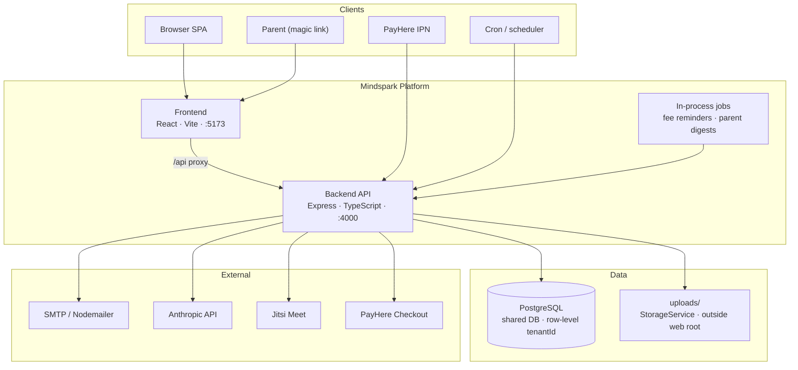
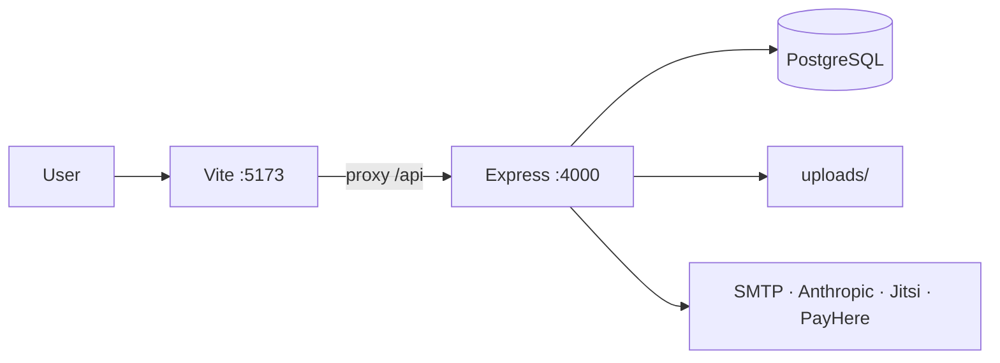
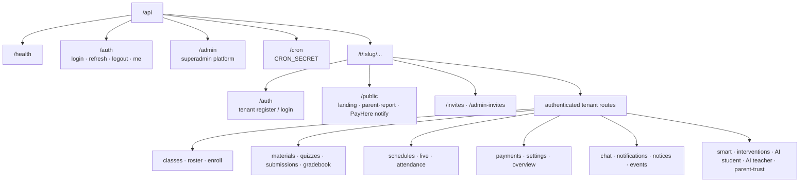
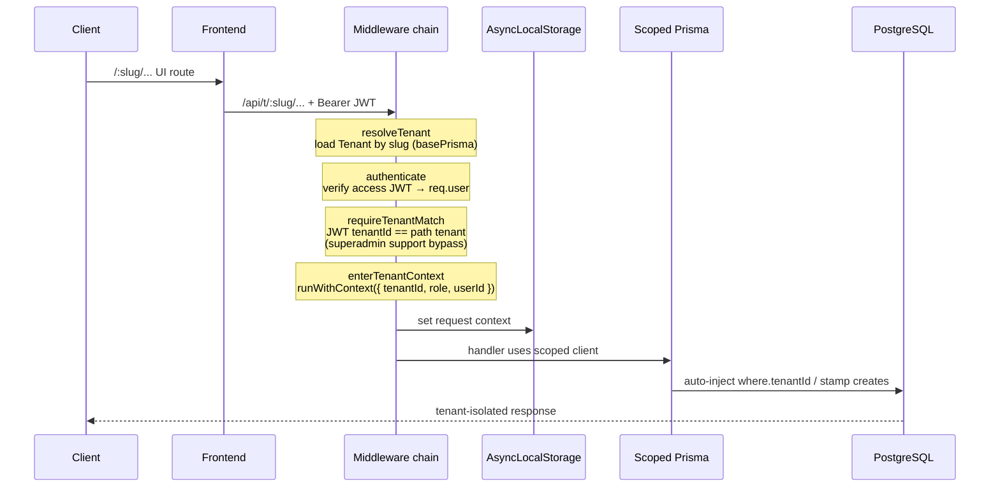
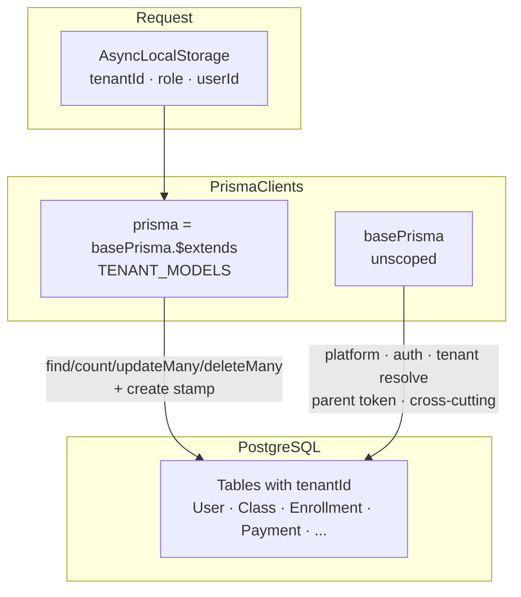
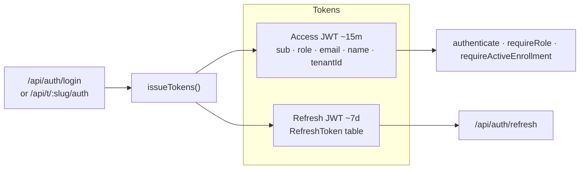
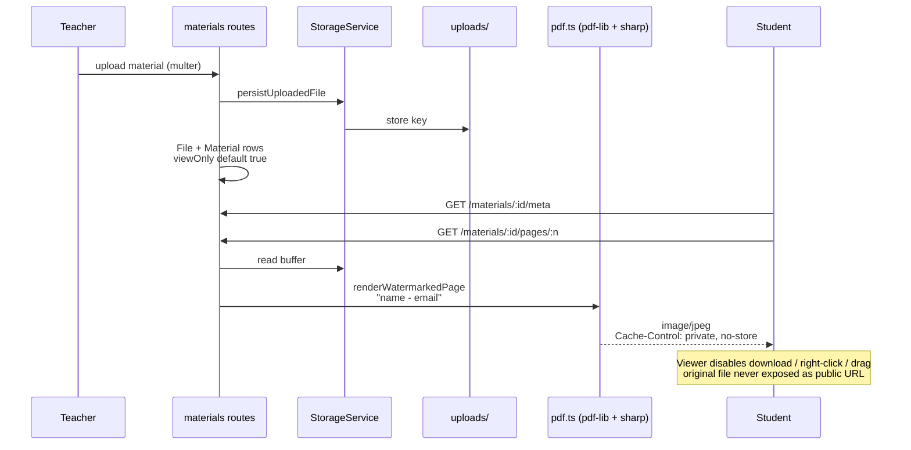
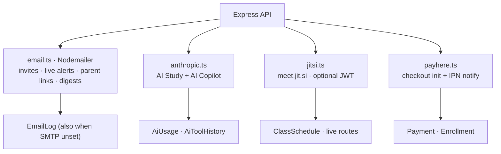
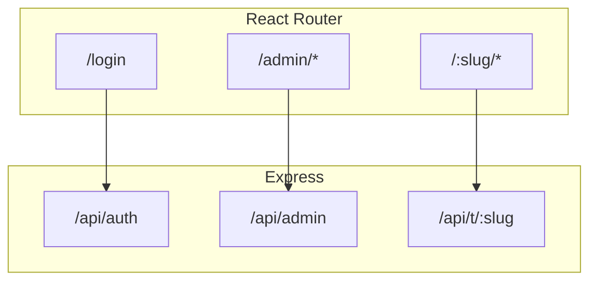

# Mindspark LMS — Architecture

System architecture diagrams for the multi-tenant Learning Management System.

**Stack:** React + Vite (frontend) · Express + TypeScript (backend) · PostgreSQL + Prisma · local disk uploads

**Docs in this set**

| Doc | Purpose |
|-----|---------|
| [architecture-current.md](./architecture-current.md) | High-level as-built architecture (diagrams) |
| [architecture-microservices.md](./architecture-microservices.md) | Production-grade microservices target architecture |
| This file | Detailed monolith maps (API, tenancy, modules) |

---

## 1. High-level system context

---

## 2. Runtime topology (local / default)

| Component | Default | Notes |
|-----------|---------|--------|
| Frontend | `http://localhost:5173` | SPA; proxies `/api` to backend |
| Backend | `http://localhost:4000` | REST API (`createApp` in `backend/src/app.ts`) |
| Database | `DATABASE_URL` | Prisma schema push + seed |
| Uploads | `UPLOAD_DIR` / `uploads/` | Not served as static public files |

---

## 3. API surface map

### Platform (`/api/admin`)

- Tenant provisioning, activate/deactivate
- Users, AI usage, payments rollup, audit
- Deep health, jobs, emails
- Support sessions into a tenant

### Tenant (`/api/t/:slug`)

- Full institute LMS surface after `resolveTenant` → `authenticate` → `requireTenantMatch` → `enterTenantContext`

---

## 4. Multi-tenant request pipeline

**Public / special paths**

| Path pattern | Middleware |
|--------------|------------|
| `/api/t/:slug/public` | `resolveTenant` → `enterTenantContext` |
| `/api/t/:slug/invites` | `resolveTenant` only |
| `/api/t/:slug/public/payhere/notify` | `resolveTenant` → `enterTenantContext` + form body |
| Authenticated `/api/t/:slug/*` | Full chain above |

Reserved UI slugs: `login`, `admin`.

---

## 5. Data isolation model

**Guarantees**

1. Every tenant-owned row carries `tenantId`.
2. Request context is set once per authenticated (or public-scoped) tenant call.
3. The extended Prisma client injects `tenantId` on bulk reads/writes and creates for models in `TENANT_MODELS`.
4. `basePrisma` is used only where isolation must be bypassed deliberately (platform ops, login, slug resolution).

---

## 6. Authentication & authorization

| Role | Scope |
|------|--------|
| `superadmin` | Platform; JWT `tenantId = null` |
| `admin` | Full institute |
| `teacher` | Own classes + assigned teach tools |
| `student` | Enrolled learning + payments + AI Study |

`UserStatus`: `pending` | `approved` | `rejected` — non-superadmins must be `approved` to sign in.  
Emails are unique per tenant: `@@unique([tenantId, email])`.

---

## 7. Protected materials pipeline

---

## 8. External integrations

| Integration | Purpose |
|-------------|---------|
| SMTP | Invites, live-class alerts, parent magic links, digests |
| Anthropic | Student AI Area + Teacher Copilot (plan-gated) |
| Jitsi | Built-in live rooms; Zoom / Teams / Meet as link platforms |
| PayHere | Online fee checkout + public notify webhook |
| Cron / jobs | Fee reminders, parent digests (`jobs/scheduler.ts`, `/api/cron`) |

---

## 9. Frontend ↔ backend alignment

| UI area | Typical API |
|---------|-------------|
| Unified login | `/api/auth` |
| Platform console | `/api/admin` |
| Institute app | `/api/t/:slug/...` |
| Public landing / parent report | `/api/t/:slug/public` |

---

## Related docs

- [Design diagrams](./design.md) — domain model, role flows, class hub, payments, quizzes, parent trust, AI
- [Client pitch](./mindspark-client-pitch.html) — presentation deck
