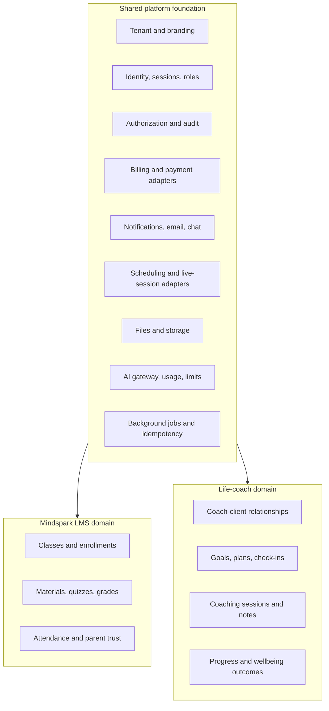

# Shared Platform Modules — Mindspark LMS and Life-Coach Platform

**Date:** 2026-08-16  
**Scope:** Reuse opportunities identified from the existing Mindspark LMS modular monolith for a future multi-tenant life-coach platform.

## Executive summary

The two products should share a **platform foundation**, not a shared LMS database or a copied set of routes. The strongest candidates are tenant isolation, identity, roles, billing, schedules, communications, files, notifications, AI integration, audit history, and operational jobs.

The LMS concepts of `Class`, `Enrollment`, `Quiz`, `Material`, `Attendance`, and school-specific parent/student rules should remain LMS-owned. The life-coach product should introduce its own `Program`, `CoachingRelationship`, `Session`, `Goal`, `Plan`, and `CheckIn` models, connected to shared platform identities and tenant boundaries.

The backend Express/Prisma foundation is the strongest reusable asset. The React UI is useful mainly as patterns and shared components, not as a life-coach product shell.

## Reuse readiness scorecard

| Capability | Readiness | Keep / adapt | Blocker before coaching reuse |
|---|---|---|---|
| Tenant isolation + plans | High | Keep context/isolation; add product modules | Scoped Prisma allowlist must stay schema-complete |
| Auth / sessions | High after hardening | Keep JWT/refresh pattern | Password recovery; remove access token from `localStorage` |
| Roles / authorization | Medium | Replace fixed role enum | Need memberships + capability policies (`coach`, `client`, coordinator, consent-scoped support) |
| Billing / PayHere | Medium | Keep webhook/idempotency pattern | Neutral orders/packages/subscriptions; drop LMS enrollment fee semantics |
| Notifications / email | Medium-high | Keep event + template approach | Preferences, quiet hours, consent |
| Scheduling / live | Medium-high | Keep provider adapter idea | Availability, timezone, cancellation/no-show, calendar sync |
| Chat | Medium | Keep persistence primitives | Threads/participants, attachments, realtime, moderation, safeguarding |
| Files / storage | Medium-high | Keep metadata + ACL idea | Object storage adapter; retention categories |
| AI gateway / quotas | Medium | Keep provider + metering | Safety/escalation, consent, non-clinical coaching use cases |
| Audit / jobs / ops | Medium-high | Keep audit + job-run records | Distributed lock/queue before multi-instance |

## Recommended boundary



## Reusable modules and resources

### 1. Multi-tenancy and product configuration — extract first

**Existing evidence**
- Tenant routing and isolation: `backend/src/middleware/tenant.ts`, `backend/src/lib/prisma.ts`
- Tenant model, plan and branding fields: `backend/prisma/schema.prisma` (`Tenant`)
- Tenant-scoped frontend API: `frontend/src/hooks/useTenantApi.ts`

**Shared capability**
- Tenant identifier and slug/domain resolution
- Product-aware feature flags and subscription plan entitlements
- Branding, contact details, and regional settings
- Tenant-scoped query enforcement

**Life-coach adaptation**
- Add a `product`/`productModules` configuration rather than assuming all tenants own LMS features.
- Give coaching tenants configurable timezone, cancellation policy, consent copy, coach directory visibility, and payment provider settings.

**Do not share unchanged**
- LMS self-enrollment rules, batches, student fee flags, and institute-specific payment wording.

**Pre-extraction risk**
- Tenant-scoped Prisma isolation in `backend/src/lib/prisma.ts` uses a manual `TENANT_MODELS` allowlist. Newer tenant-owned models such as `AiStaffUsage`, `ClassInviteLink`, and `SelfEnrollmentRule*` must be included (or generated from schema) before this pattern is treated as a shared platform guarantee.

### 2. Identity, sessions, and authorization — extract first

**Existing evidence**
- Users and refresh sessions: `backend/prisma/schema.prisma` (`User`, `RefreshToken`)
- JWT/cookie flow: `backend/src/routes/auth.ts`, `backend/src/services/auth.ts`, `backend/src/utils/authCookies.ts`
- Role middleware: `backend/src/middleware/auth.ts`
- Privileged support access: `backend/src/services/supportSession.ts`

**Shared capability**
- Account lifecycle, password handling, JWT/refresh sessions, session revocation
- Tenant membership and role assignment
- Route/action authorization
- Superadmin support sessions with audit trail

**Life-coach adaptation**
- Use neutral roles such as `tenant_admin`, `practitioner`, `client`, and optional `assistant`.
- Model memberships separately from global users so one person can be a client in one tenant and a coach in another.
- Add consent and data-access boundaries for private coaching notes.

**Important hardening before reuse**
- Move access tokens out of `localStorage` into in-memory state while retaining HttpOnly refresh cookies.
- Add password recovery before using this foundation for client-facing coaching access.

### 3. Billing, payments, invoices, and entitlements — extract as an adapter layer

**Existing evidence**
- Payment model and payment statuses: `backend/prisma/schema.prisma` (`Payment`)
- Payment routes and duplicate-attempt control: `backend/src/routes/payments.ts`
- PayHere checkout/IPN adapter: `backend/src/services/payhere.ts`
- Fee calculation: `backend/src/lib/fees.ts`

**Shared capability**
- Payment provider adapter contract: create checkout, validate webhook, reconcile status
- Payment attempt/idempotency handling
- Invoice/receipt records and payment notifications
- Entitlement decision point after successful payment

**Life-coach adaptation**
- Support one-off session payments, packages, subscriptions, deposits, refunds, and cancellations.
- Replace LMS-specific `Enrollment` linkage with a neutral `BillableItem` or `Purchase`.
- Make entitlement rules explicit: a successful payment may unlock a package, booking, resource, or membership.

**Do not share unchanged**
- The LMS rule that paid enrollment is pending until an enrollment payment is approved, and the current-month class access gate.

### 4. Scheduling and live-session integration — extract as a shared service

**Existing evidence**
- Schedule persistence and routes: `backend/src/routes/schedules.ts`
- Live entry and meeting privacy: `backend/src/routes/live.ts`
- Jitsi adapter: `backend/src/services/jitsi.ts`
- External meeting URL safeguards: `backend/src/utils/safeUrl.ts`

**Shared capability**
- Appointment/session scheduling
- Provider abstraction for Jitsi, Zoom, Teams, Google Meet, and external links
- Authorized just-in-time meeting link retrieval
- Reminder hooks and session state (`scheduled`, `live`, `ended`, `cancelled`)

**Life-coach adaptation**
- Add availability, buffers, booking windows, rescheduling, cancellation policy, no-show status, and calendar sync.
- Treat LMS recurring class schedules as a separate policy from coaching appointments.

### 5. Communication and notifications — extract with templated events

**Existing evidence**
- In-app notifications: `backend/src/services/notifications.ts`, `backend/src/routes/notifications.ts`
- Transactional mail and layouts: `backend/src/services/email.ts`, `backend/src/services/emailLayout.ts`
- Tenant conversations: `backend/src/routes/chat.ts`

**Shared capability**
- Event-driven notification API: recipient, channel, template, related resource, deep link
- Email layouts, delivery logs, failure visibility
- In-app notification feed and unread state
- Secure direct messaging primitives

**Life-coach adaptation**
- Add client communication preferences, quiet hours, consent, coach-client conversation scopes, and retained/private note separation.
- Use neutral events such as `session_reminder`, `payment_received`, `goal_checkin_due`, and `coach_message`.

**Chat constraints in the current LMS**
- Conversations are effectively staff-to-student and enrollment-linked.
- Delivery is HTTP polling, not realtime.
- There is no attachment, retention, moderation, or safeguarding workflow yet — all required for coaching.

### 6. Files and secure document handling — extract after replacing local-disk coupling

**Existing evidence**
- File metadata: `backend/prisma/schema.prisma` (`File`)
- Upload/storage abstraction: `backend/src/services/files.ts`, `backend/src/services/storage.ts`
- PDF page rendering/watermarking: `backend/src/services/pdf.ts`

**Shared capability**
- Tenant-owned file metadata, ownership, MIME/type policy, access checks, retention controls
- Signed/private download or stream API
- Optional document rendering and watermarking

**Life-coach adaptation**
- Add sensitive categories: intake forms, consent documents, worksheets, and client uploads.
- Add retention schedules and stronger access controls for private health/wellbeing-adjacent information.

**Required platform change**
- Replace local disk with an object-storage adapter before a second product or multiple runtime instances rely on it.

### 7. AI gateway, quotas, and safety controls — extract as a provider-neutral capability

**Existing evidence**
- Anthropic integration: `backend/src/services/anthropic.ts`
- Student/teacher AI services: `backend/src/services/aiStudent.ts`, `backend/src/services/aiTeacher.ts`, `backend/src/services/aiCoach.ts`
- Usage records: `AiUsage`, `AiStaffUsage`, `AiToolHistory` in `backend/prisma/schema.prisma`

**Shared capability**
- Provider abstraction, prompts by named use case, timeout/error handling
- Per-user/per-tenant usage accounting and quota enforcement
- Audit metadata without storing unnecessary prompt content
- Feature gating by tenant plan

**Life-coach adaptation**
- Build bounded tools such as reflection prompts, goal planning, accountability summaries, and session preparation.
- Add clear non-clinical positioning, crisis/escalation wording, and policy-driven refusal/escalation paths.

**Do not share unchanged**
- Student tutoring and quiz-generation prompts; these encode educational assumptions.

### 8. Audit, operational jobs, and platform administration — extract first

**Existing evidence**
- Audit service/logs: `backend/src/services/audit.ts`, `AuditLog`
- Job run records: `backend/src/services/jobRuns.ts`, `JobRun`
- Scheduler: `backend/src/jobs/scheduler.ts`, `backend/src/services/smartJobs.ts`
- Platform operations routes: `backend/src/routes/platformOps.ts`

**Shared capability**
- Actor/action/resource audit events
- Background job registry, run history, retries, and idempotency keys
- Tenant administration, support tooling, health checks, and feature controls

**Life-coach adaptation**
- Audit access to private client notes, exports, payment reviews, and role changes.
- Create jobs for reminders, recurring check-ins, package expiry, and failed payment follow-up.

**Required platform change**
- Move in-process scheduled work to a dedicated worker/queue or add a distributed lock before both products run horizontally.

## Domain models to create for the life-coach product

These are product-specific models that should reference shared `Tenant`, `User`, `File`, `Payment`, `Notification`, and `AuditLog` resources:

- `CoachProfile`: credentials, bio, specialties, availability, booking policy
- `ClientProfile`: preferences, timezone, consent status, emergency-resource region
- `CoachingRelationship`: coach/client assignment, status, package entitlement, access boundaries
- `CoachingSession`: time, duration, meeting provider, status, cancellation/no-show outcome
- `SessionNote`: private practitioner note, optional client-visible summary, retention and access policy
- `Goal`: client goal, target date, visibility, progress state
- `ActionPlan` / `ActionItem`: commitments, cadence, completion and reminder state
- `CheckIn`: structured reflections, score trends, coach response
- `ResourceLibraryItem`: worksheets, guided exercises, media, coach/tenant visibility
- `Package` / `Subscription`: commercial offering and entitlement policy

## Delivery sequence

Best extraction order for both products:

1. **Tenant/auth foundation**
   - Tenant context, identity, sessions, support access, audit events.
2. **Memberships / authorization**
   - Capability-based access instead of LMS-only roles.
3. **Storage + notifications**
   - Object storage adapter, email/in-app event dispatcher, delivery logs.
4. **Scheduling / live adapters**
   - Neutral session model and meeting-provider contracts.
5. **Billing providers**
   - Keep webhook verification and payment-attempt uniqueness; replace enrollment fee model.
6. **Audit / reporting / jobs**
   - Durable queue or distributed lock; domain-neutral metrics.
7. **Chat and AI safety**
   - Coach-client messaging, consent, escalation, usage metering.

Within that sequence:

1. Create shared platform packages while keeping one deployable API initially.
2. Neutralize schema language (`Membership`, `Entitlement`, `PaymentAttempt`) without renaming LMS tables in place until a migration plan exists.
3. Build the life-coach domain on shared interfaces.
4. Harden infrastructure before multi-product scale: object storage, job locking, token/CSP hardening, password recovery, provider health checks.

## Suggested repository shape

```text
products/
  mindspark-lms/
  life-coach/
packages/
  platform-auth/
  platform-tenancy/
  platform-access/
  platform-billing/
  platform-notifications/
  platform-files/
  platform-ai/
  platform-scheduling/
  platform-audit/
  platform-jobs/
```

For the current codebase, begin by extracting service interfaces and shared types into packages while retaining the existing Express application. Avoid splitting databases or creating networked microservices until there is a concrete scale, deployment, or team-boundary need.

