# Mindspark LMS — Design

Domain and product design diagrams: entities, roles, class hub, and key flows.

---

## 1. Domain model (core entities)

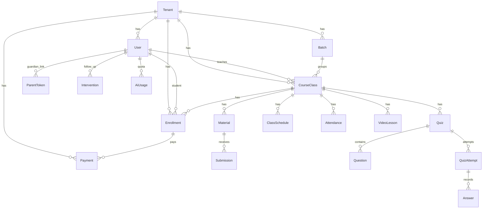

> Mermaid reserves `Class`, so the diagram uses `CourseClass` for the Prisma `Class` model.

### Key models (summary)

| Model | Purpose |
|-------|---------|
| **Tenant** | Institute / tutor workspace (slug, branding, plan) |
| **User** | `superadmin` \| `admin` \| `teacher` \| `student` |
| **Batch** | Groups classes |
| **Class** | Learning unit; optional price; teacher-owned |
| **Enrollment** | Student ↔ class (`pending` \| `active` \| `rejected`) |
| **Payment** | Slip / PayHere; `enrollment` \| `monthly` |
| **Material** | Notes / assessments; view-only by default |
| **Submission** | Student file + grade for assessments |
| **Quiz / Question / QuizAttempt / Answer** | MCQ lifecycle; one attempt per student |
| **ClassSchedule** | Live / meeting sessions (Jitsi, Zoom, Teams, Meet) |
| **Attendance** | Presence by session date |
| **VideoLesson / ClassTopic** | Content with visibility (all / class / batch) |
| **Notice / Event** | Institute communications |
| **Conversation / Message** | Teacher/admin ↔ student chat |
| **ParentToken** | Magic-link parent access |
| **Intervention / AiUsage / AiToolHistory** | Ops intelligence + AI quotas |

---

## 2. Role & responsibility design

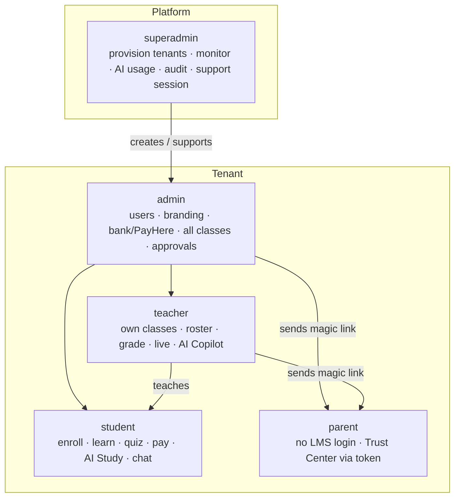

| Role | Primary surfaces |
|------|------------------|
| Super-admin | `/admin/*` platform console |
| Admin | `/:slug/dashboard`, settings, payments, all teach tools |
| Teacher | Class hub, attendance, interventions, AI Copilot |
| Student | Catalog, class content, quizzes, payments, AI Study |
| Parent | `/:slug/parent?token=…` report only |

---

## 3. Class hub information architecture

Class routes: `/:slug/classes/:classId/:section`

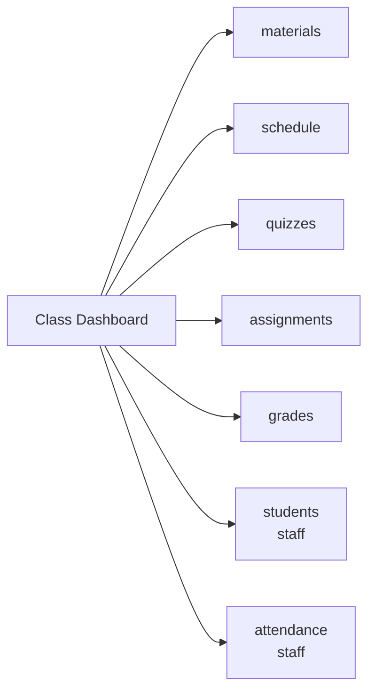

| Section | Audience | Purpose |
|---------|----------|---------|
| Materials | All enrolled / staff | View-only PDFs & notes |
| Schedules | All / staff manage | Sessions + live join |
| Quizzes | Students take · staff build | MCQ + leaderboard |
| Assignments | Students submit · staff grade | File submissions |
| Grades | Staff (+ student views as designed) | Gradebook / export |
| Students | Staff | Roster, invites, ID cards |
| Attendance | Staff | Mark presence |

Related standalone pages: material viewer, quiz take, quiz result.

---

## 4. Enrollment & payment design

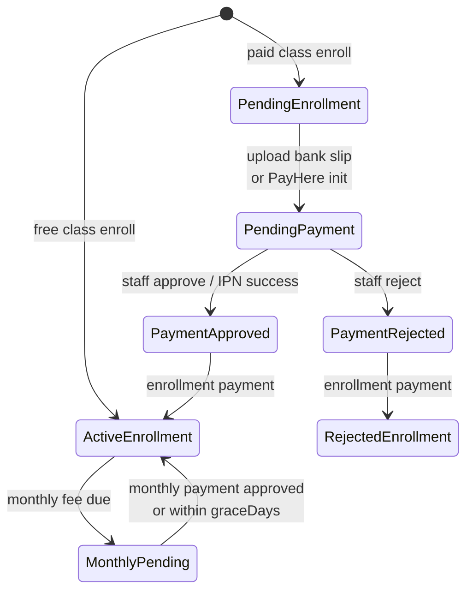

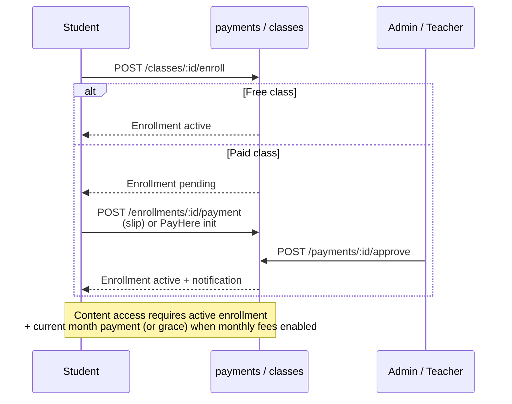

**Content gate (`studentHasContentAccess`)**

1. Enrollment must be `active`
2. If class is paid and monthly payment is required: approved payment for current `YYYY-MM` **or** day-of-month ≤ `graceDays`

---

## 5. Quiz attempt design

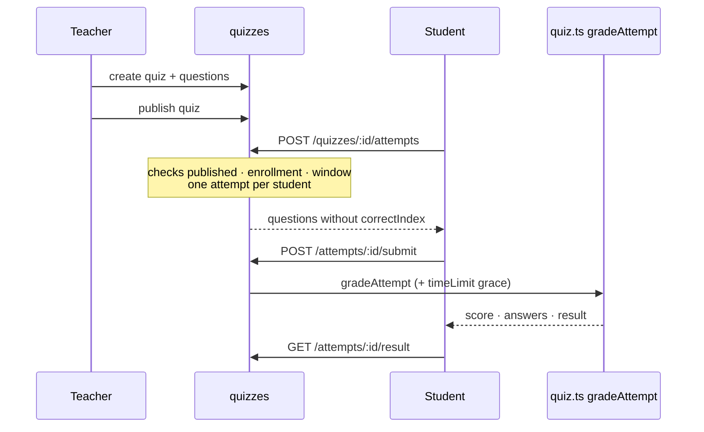

**Rules**

- Single attempt: `@@unique([quizId, studentId])`
- Timed quizzes enforce `timeLimitSec` (+ short grace)
- Correct answers withheld until submit / result

---

## 6. Parent Trust Center design

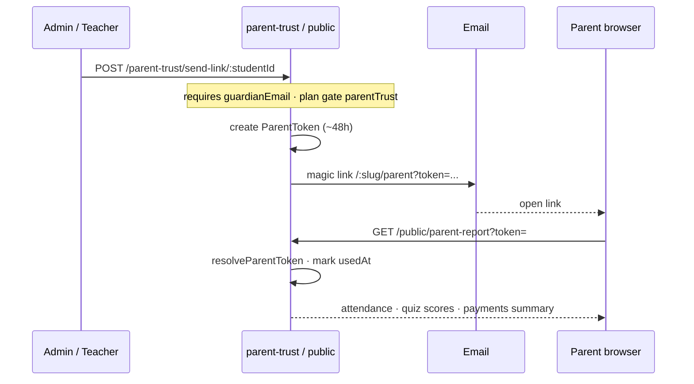

**Access model**

- Parent has **no** LMS role/login
- Token is tenant-scoped, time-limited, plan-gated (`parentTrust`)
- Report is read-only (attendance window, quiz performance, payment summary)

---

## 7. Live class design

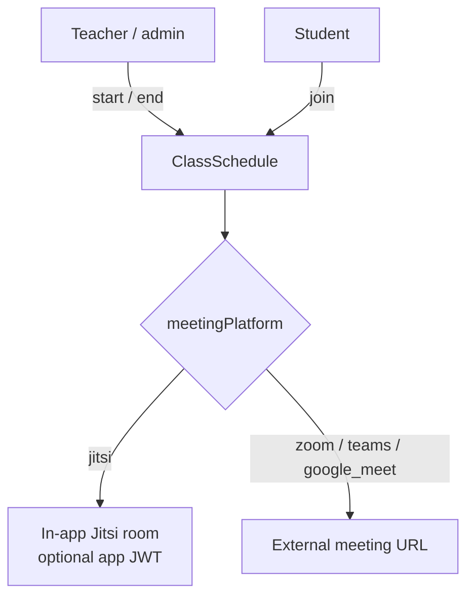

Supporting surfaces: live upcoming list, instant live rooms, email alerts when sessions go live.

---

## 8. AI feature design

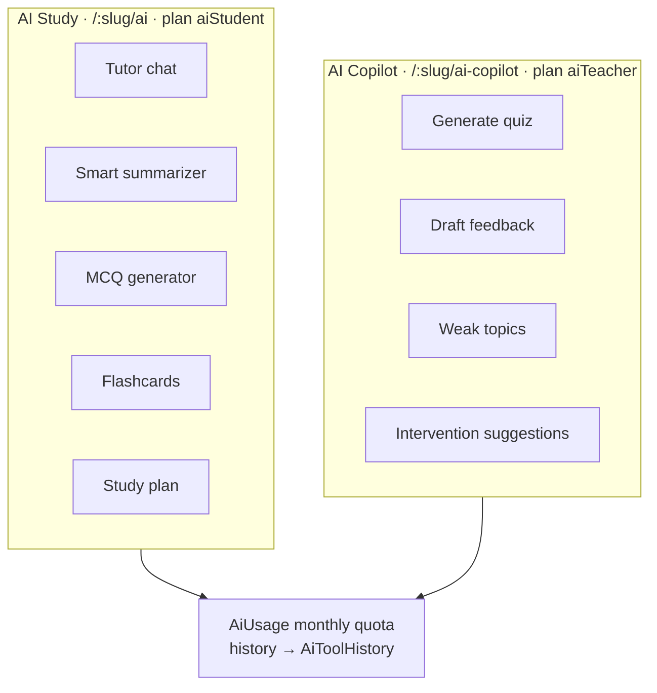

| Audience | Constraints |
|----------|-------------|
| Student | Active enrollment; monthly quota |
| Teacher | Own classes only |
| Admin | Any class in tenant |
| Platform | `/api/admin/ai/usage` rollup |

Related ops: Smart Ops at-risk lists, attempt explain, weak-topic analysis, intervention timeline.

---

## 9. Institute product map (nav intent)

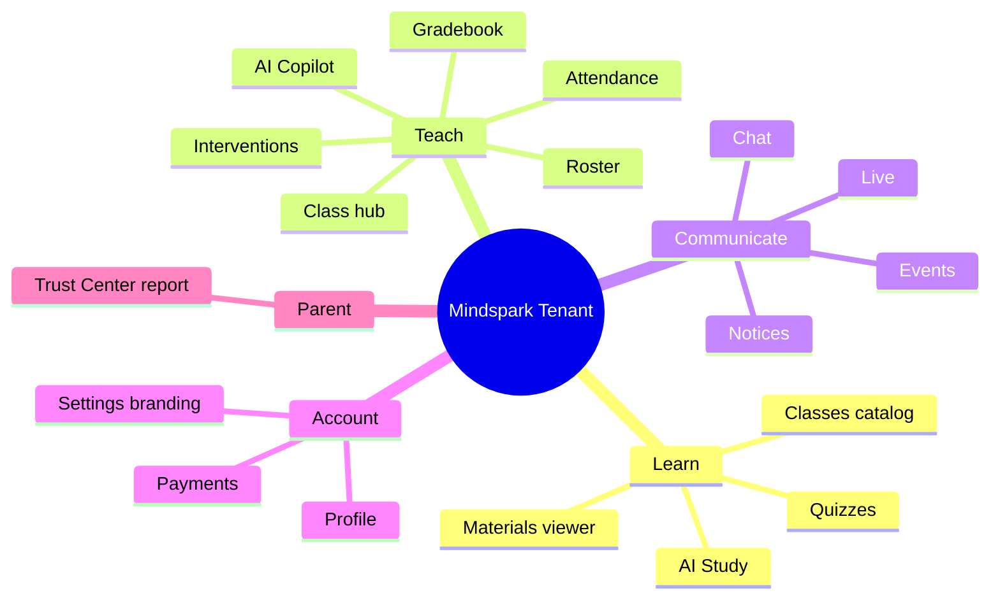

---

## 10. End-to-end student journey

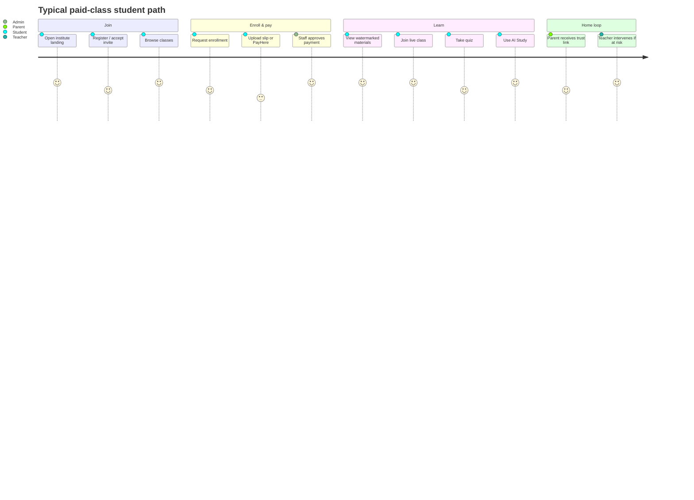

---

## Related docs

- [Architecture diagrams](./architecture.md) — system context, tenancy, auth, storage, integrations
- [Client pitch](./mindspark-client-pitch.html) — presentation deck
