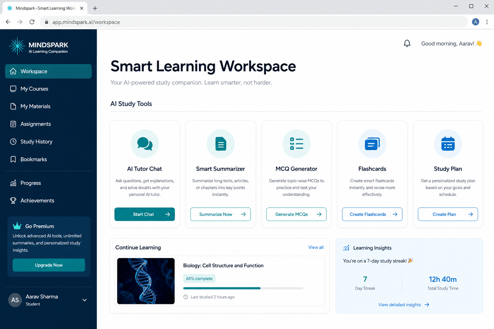
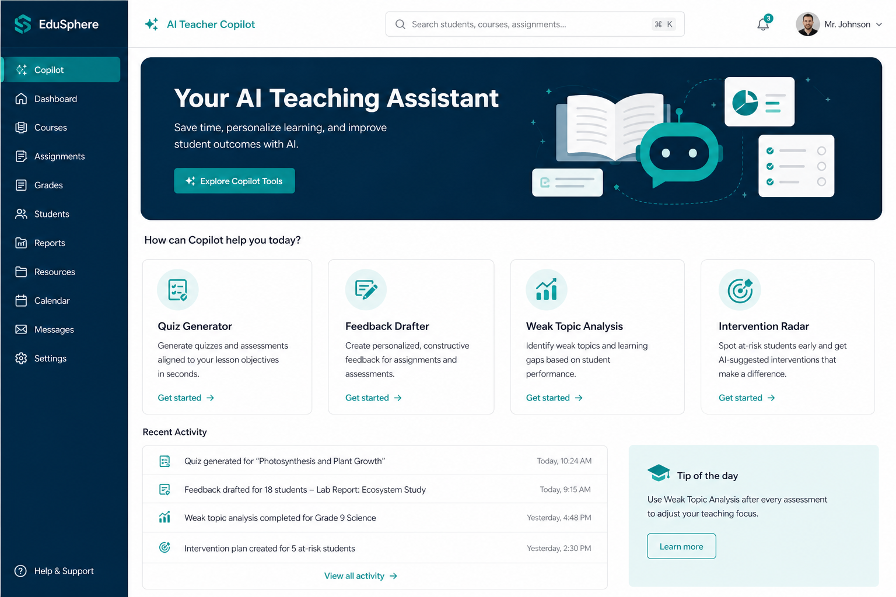
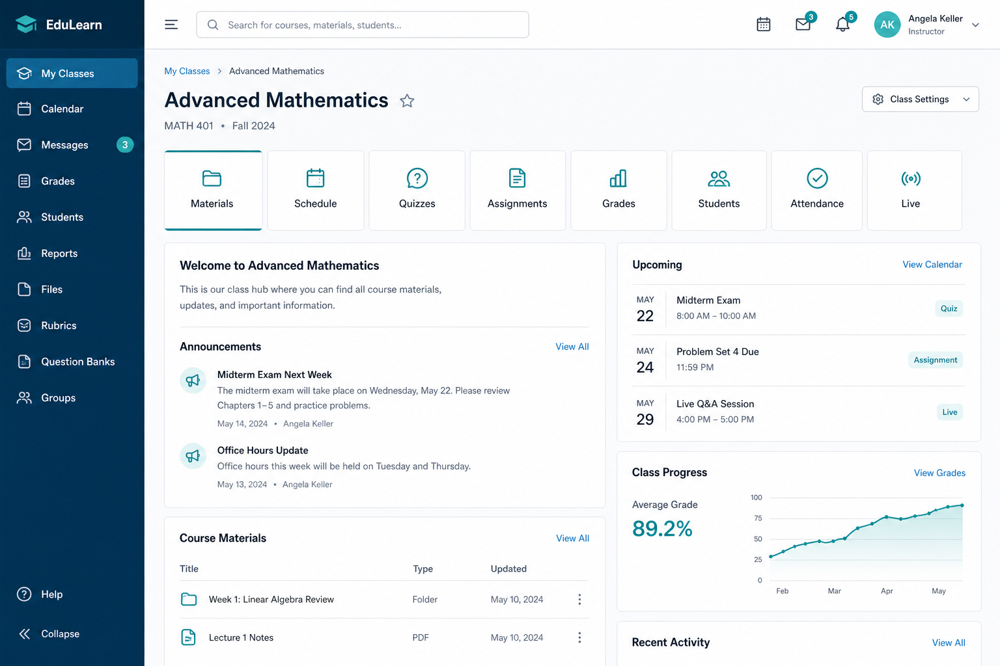
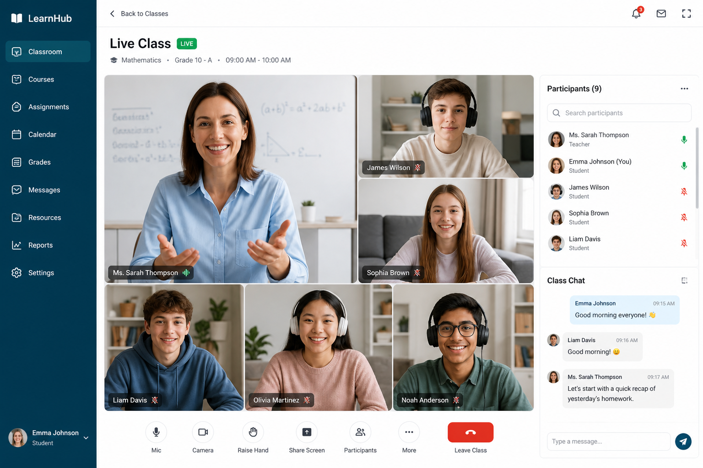
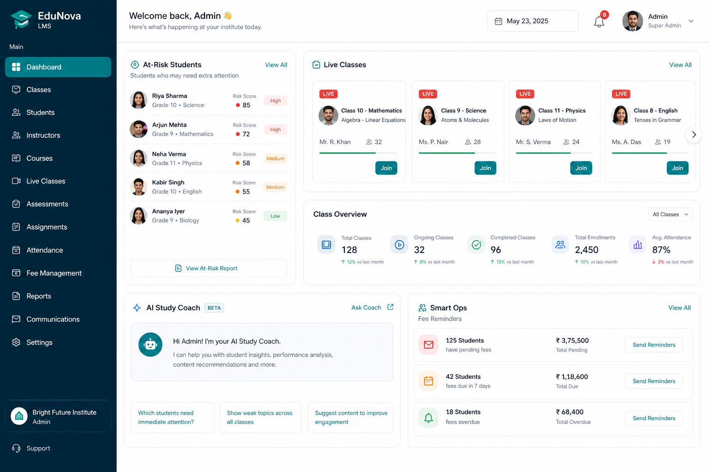

# Mindspark LMS — Feature Summary

**Product:** Mindspark LMS (AI-first, multi-tenant learning platform for institutes & tutors)  
**Audience:** Product, sales, partners, and marketing  
**Updated:** 7 September 2026  

> **Screenshot note:** Images below are **illustrative UI mockups** for decks and handoffs. Replace with live product captures from a demo tenant when preparing client-facing collateral.

**Positioning line:** *Learn smarter. Teach clearer.* — one branded institute space for classes, live teaching, assessments, payments, and AI.

---

## At a glance

| Pillar | What it delivers |
|--------|------------------|
| **Teach** | Classes, materials, live rooms, quizzes, assignments, gradebook |
| **Operate** | Enrollment, attendance, fees, branding, ID cards |
| **Improve** | AI Study for students, AI Copilot for teachers, at-risk + parent trust |

---

## 1. AI Study (students)

**Route:** `/:slug/ai` · Nav: **AI Study**  
**Hub:** Smart Learning Workspace — class-scoped tools with monthly AI quota and saved history.

| Feature | Description |
|---------|-------------|
| **AI Tutor Chat** | Real-time Q&A on concepts from the selected class, with structured sectioned answers. |
| **Smart Summarizer** | Paste or upload notes (PDF / Word / TXT) and get a clear key-point summary. |
| **MCQ Generator** | Practice questions from a topic or notes; students can pull the next AI question. |
| **Flashcards** | Turn a topic or notes into flip-style revision cards. |
| **Study Plan** | Build a focused **7-day** plan from subject, unit, and topic. |

**Why it matters:** Students get on-demand help without waiting for the next live session — tutor, revise, practice, and plan in one place.

---

## 2. AI Teacher Copilot

**Route:** `/:slug/ai-copilot` · Nav: **AI Copilot**  
**For:** Teachers and institute admins · History saved per tool.

| Feature | Description |
|---------|-------------|
| **Quiz Generator** | Generate MCQs from a topic or lesson notes; attach files; publish into a class quiz. |
| **Feedback Drafter** | Rubric-style constructive feedback with suggested grade, strengths, and improvements. |
| **Weak Topic Analysis** | Class-wide quiz analysis: topics students struggle with + suggested focus. |
| **Intervention Radar** | Surface at-risk students with AI-suggested next actions (priority-aware). |

**Why it matters:** Prep and intervention scale with the class size — less time writing quizzes/feedback, more time teaching and supporting.

---

## 3. Class hub & learning core

**Route:** `/:slug/classes` → `/:slug/classes/:classId/...`

| Area | Description |
|------|-------------|
| **Classes & batches** | Create/manage classes, pricing, teacher assignment; students browse and join when self-enrollment is open. |
| **Materials** | Notes and PDFs; secure page-by-page viewing (protected content path). |
| **Schedule** | Upcoming sessions with Zoom / Teams / Meet / **Jitsi Live Class** links. |
| **Quizzes** | Builder, timed attempts, auto-score, AI generate, leaderboard, results. |
| **Assignments** | Submissions, feedback, and marking. |
| **Grades** | Gradebook / performance views; staff can filter weak performers. |
| **Roster & attendance** | Invite/approve students, ID cards, join links; mark attendance per session. |
| **Videos** | Recorded lessons (class / playlist views). |
| **Announcements & events** | Institute notices and events (audience targeting; pinned on public landing). |

---

## 4. Live class & chat

| Feature | Description |
|---------|-------------|
| **Live Class** | Upcoming and active sessions across classes; instant meeting; Jitsi room + external join (Zoom / Meet / Teams). |
| **Chat** | Message teachers and students; history saved; class filters and contacts. |

---

## 5. Smart ops, at-risk & parent trust

| Feature | Who | Description |
|---------|-----|-------------|
| **Role dashboards** | Admin / teacher / student | Ops home with shortcuts into AI, live, payments, and attention items. |
| **At-risk panel** | Teacher, admin | Flags from low attendance, missing work, or weak quiz scores (e.g. last 30 days). |
| **Intervention timeline** | Teacher, admin | Log, track, and resolve interventions (open → in progress → resolved / escalated). |
| **AI study coach** | Student | Weak-topic summary on the student dashboard with a CTA into AI Study. |
| **Fee & parent alerts** | Admin | Fee reminders (e.g. last week of month) and parent digests from SmartOps. |
| **Parent Trust Center** | Parent (token link) | No-login progress view: attendance, quizzes, fees. |
| **Payments** | Student / staff | Monthly slip upload + approval; optional **PayHere**; bank details and grace days in settings. |

---

## 6. Multi-tenant platform & admin

| Feature | Description |
|---------|-------------|
| **Institute landing** | Public branded page at `/:slug` — logo, events, lessons, notices; Register / Sign in. |
| **White-label settings** | Logo, bank details, monthly fee rules, self-enrollment, PayHere. |
| **Auth flows** | Platform login with multi-institute picker; student register; invite & class join tokens; admin invite. |
| **Superadmin console** | Tenants, users, monitoring, AI usage metering, platform payments, audit log. |

---

## Role map (quick)

| Role | Primary jobs in product |
|------|-------------------------|
| **Institute admin** | Users, teachers, settings, branding, payments, oversight, SmartOps |
| **Teacher** | Class hub, roster, attendance, grading, live, chat, AI Copilot, interventions |
| **Student** | Enroll, materials, quizzes, live, chat, fees, AI Study |
| **Parent** | Token Trust Center (attendance, quiz, payment summary) |
| **Platform superadmin** | Provision tenants, plans, health, AI usage, support |

---

## Marketing thoughts & plan

These are current recommendations aligned with the product as built (and the existing client pitch in `docs/mindspark-client-pitch.html`). They are **not** a committed GTM budget plan.

### Positioning

Lead with **one sentence**:

> **Mindspark is the AI-first LMS for institutes and tutors — teach, collect fees, and catch at-risk students before they drop — under each institute’s own brand.**

Avoid “another quiz + Zoom wrapper.” Differentiation that holds up in demos:

1. **AI on both sides of the classroom** (Study + Copilot), not chatbot-only.  
2. **Intervene early** (at-risk + intervention timeline + parent link).  
3. **Local ops fit** (bank slips / PayHere, ID cards, guardian fields, white-label landing).  
4. **True multi-tenant SaaS** (isolated institutes, platform metering for AI).

### Primary ICP (near term)

1. **Tuition / coaching institutes** (single or multi-branch) that already charge monthly fees and run live batches.  
2. **Subject tutors / small academies** outgrowing WhatsApp + Drive + separate Zoom.  
3. Secondary: school departments / private institutes that want branded parent visibility.

### Message house

| Audience | Hook | Proof in demo |
|----------|------|----------------|
| **Owner / admin** | “Fees, branding, and risk in one place” | Settings → payments → at-risk → parent digest |
| **Teacher** | “Prep in minutes, support the right students” | Quiz gen → weak topics → intervention |
| **Student / parent** | “Help when stuck + clear progress” | AI Tutor + Trust Center |

### Channel mix (practical)

| Channel | Play |
|---------|------|
| **Live demo / pilot** | 1 batch, 2–4 weeks; measure quiz completion, fee collection, interventions logged. |
| **8s + 15–30s video** | AI-first hook (already drafted); use on landing, WhatsApp, LinkedIn, YouTube Shorts. |
| **Pitch deck** | Reuse `mindspark-client-pitch.html`; swap mockups for real screenshots ASAP. |
| **WhatsApp / Facebook** | Institute owner groups; short clips + “book a demo” CTA. |
| **Partner tutors** | Referral: free/ discounted first month for referred institutes. |
| **SEO / site** | Landing: “AI LMS for tuition institutes” + feature pages for AI Study / Copilot / Parent Trust. |

### Near-term marketing backlog

1. **Replace mockups** in this doc with real captures (student AI hub, Copilot, dashboard, live, payments, parent report).  
2. **One-pager PDF** (1 page): problem → 3 pillars → AI split → CTA.  
3. **Demo script** (12 minutes): admin branding → teacher quiz gen → student tutor → at-risk → parent link.  
4. **Case study template** after first pilot (fees collected %, interventions closed, teacher time saved).  
5. **Pricing narrative** tied to plans + AI quotas (visible to superadmin) so usage feels controlled, not open-ended cost.  
6. **Trust content**: content protection / watermarked materials + parent Trust Center (privacy-safe token links).

### What not to oversell yet

- Do not imply a native mobile app if you only ship web.  
- Prefer “AI study coach + teacher copilot” over vague “powered by AI.”  
- Keep claims tied to shipped tools (tutor, summarizer, MCQ, flashcards, study plan, quiz gen, feedback, weak topics, intervention).

### Suggested next 30 days

| Week | Focus |
|------|--------|
| 1 | Real screenshots + update this doc + pitch HTML |
| 2 | Ship 8s promo + demo booking link on login/landing |
| 3 | 3–5 institute demos using the 12-min script |
| 4 | Convert 1 pilot; capture metrics for a short case blurb |

---

## Related assets

| Asset | Path |
|-------|------|
| Client pitch deck (HTML) | [`docs/mindspark-client-pitch.html`](./mindspark-client-pitch.html) |
| Feature images | [`docs/features/`](./features/) |
| Brand logo | [`docs/mindspark-logo.png`](./mindspark-logo.png) |
| UI/UX audit | [`docs/uiux-audit-findings.md`](./uiux-audit-findings.md) |

---

## Screenshot capture checklist (live product)

When the demo tenant is up, capture and replace files in `docs/features/`:

- [ ] `feature-ai-student-workspace.png` — `/ai` hub  
- [ ] `feature-ai-teacher-copilot.png` — `/ai-copilot`  
- [ ] `feature-dashboard-insights.png` — admin or teacher dashboard  
- [ ] `feature-class-hub.png` — class home  
- [ ] `feature-live-class.png` — live session  
- [ ] Optional: payments approval, parent Trust Center, materials viewer, quiz take  

Use consistent window size (e.g. 1440×900), light mode first, institute logo visible, no demo credentials in frame.
