# Notification & Delivery Platform — Design Diagrams

**Companion to:** [notification-email-microservice.md](./notification-email-microservice.md)  
**Audience:** Architects, platform engineers, product integrators

---

## 1. System context (who talks to whom)

High-level view of the shared notification platform across multiple products.

**Why two boxes?** The **Notification Delivery Platform** is what your team builds and owns (API, inbox, workers, queue, DB). **Shared / external** items are either used by many services (event bus) or operated by a third party (SES/SMTP). The queue and workers belong **inside** the platform; they were omitted in an earlier sketch for simplicity.

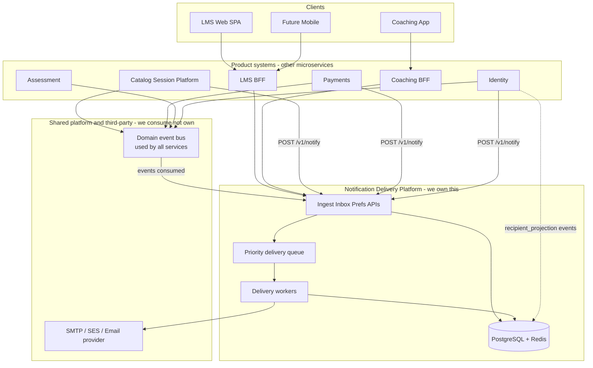

### Inside vs outside the platform

| Inside Notification Delivery Platform | Outside (shared / third-party) |
|---------------------------------------|--------------------------------|
| Ingest, Inbox, Preferences APIs | Domain event bus (Catalog, Payments, Assessment also publish) |
| Delivery workers | AWS SES / SMTP / SendGrid |
| Internal priority queue | Identity service (source of user email) |
| PostgreSQL, Redis | Tenant Config (branding read by notify) |
| Template packs, channel adapter **code** | Actual mail infrastructure the adapter calls |

The **event bus is not inside** the notification service because it is **platform-wide**: Catalog emits `SessionScheduled`, Payments emits `PaymentApproved`, and Notification subscribes — one bus, many publishers. Putting it inside the notification box would wrongly imply only notifications use it.

The **email provider is not inside** because you integrate with it (like PayHere or Jitsi); you do not operate it.

For module-level detail (everything inside the platform box), see **Diagram 2** below.

---

## 2. Logical architecture (modules inside the platform)

Modular monolith in Phase 0; Delivery workers peel first at scale.

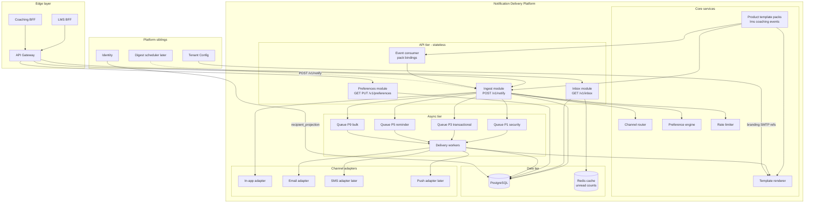

---

## 3. Notify flow (sequence)

End-to-end path from producer to delivered notification.

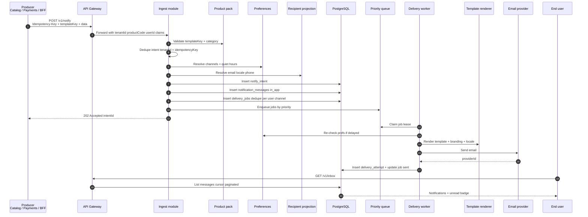

---

## 4. Multi-product integration

How LMS, coaching, and future products share one platform without forking.

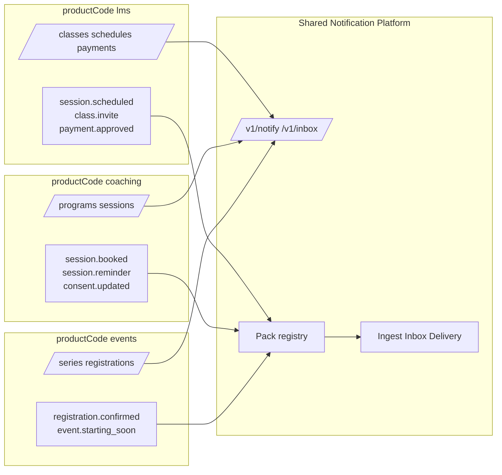

---

## 5. Data model (core entities)

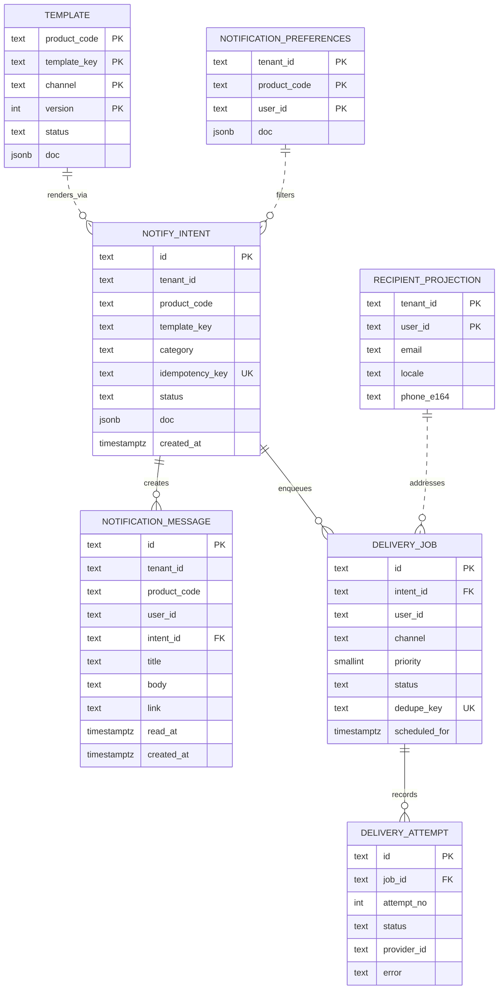

---

## 6. Channel routing & categories

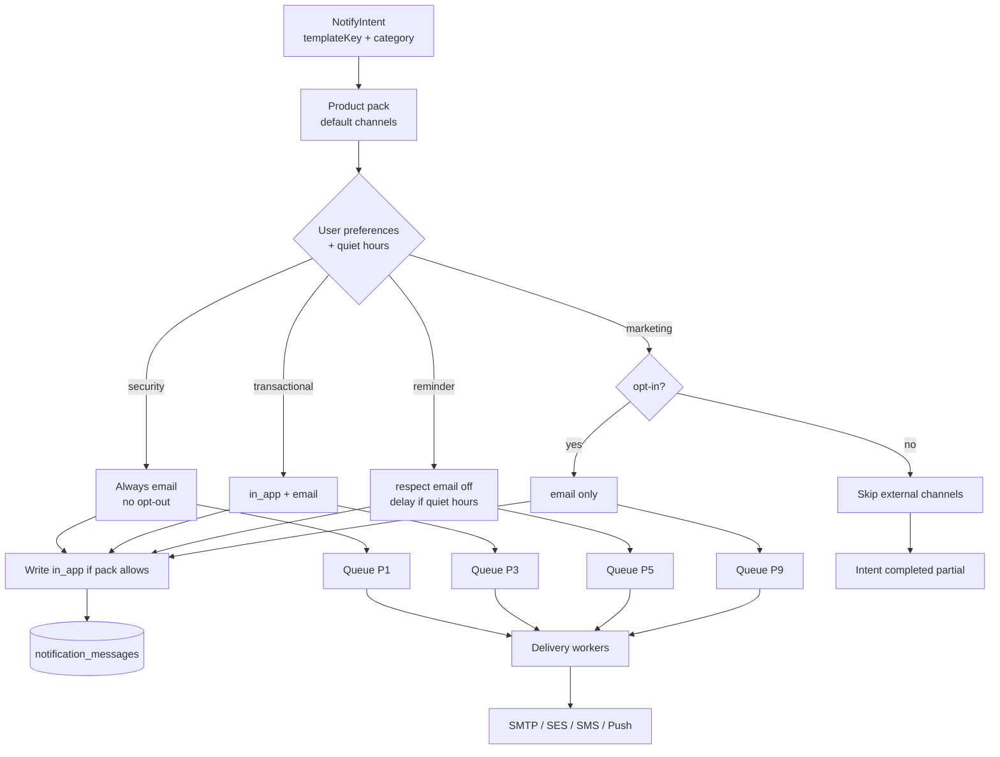

---

## 7. Event-driven integration

Domain events from other platform services trigger notifications via pack bindings.

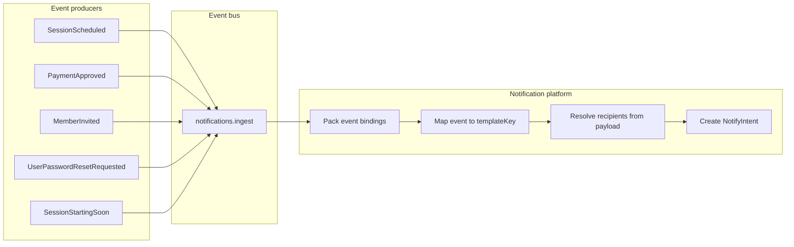

**Example bindings (lms pack):**

| Event | templateKey | Recipients |
|-------|-------------|------------|
| `SessionScheduled` | `session.scheduled` | `event.participantUserIds` |
| `PaymentApproved` | `payment.approved` | `event.userId` |
| `MemberInvited` | `class.invite` | `event.inviteeEmail` or `event.userId` |
| `UserPasswordResetRequested` | `auth.password_reset` | `event.userId` |

---

## 8. Deployment topology (Phase 0 → Phase 1)

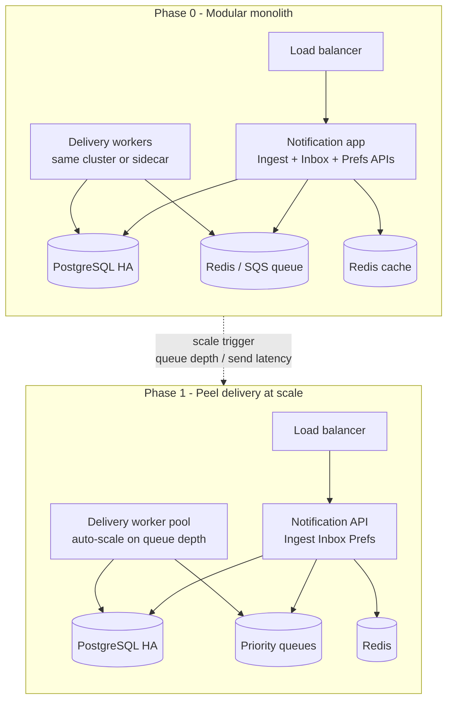

---

## 9. BFF mapping (product UX vs platform API)

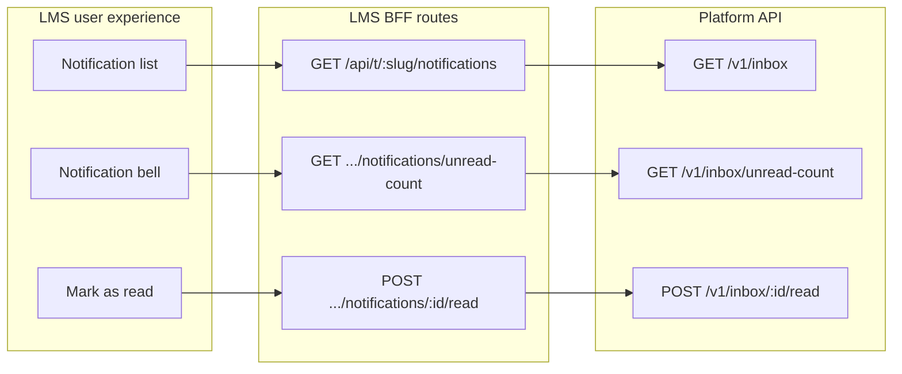

---

## 10. Security & privacy boundaries

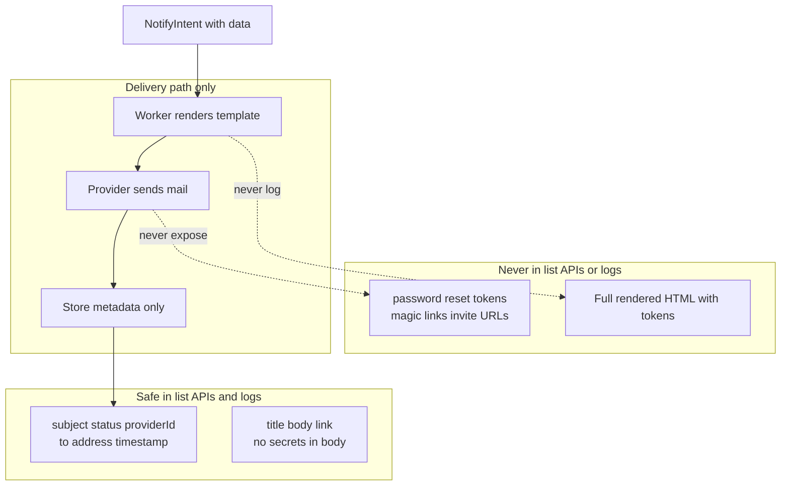

---

## 11. Scale evolution roadmap

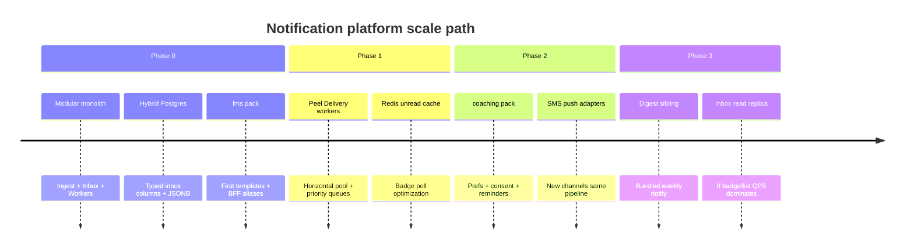

---

## Diagram index

| # | Diagram | Use when |
|---|---------|----------|
| 1 | System context | Explaining platform placement to stakeholders |
| 2 | Logical architecture | Engineering onboarding / service boundaries |
| 3 | Notify sequence | Implementing ingest + delivery |
| 4 | Multi-product integration | Adding a new productCode |
| 5 | Data model | Database design / migrations |
| 6 | Channel routing | Preferences and quiet hours logic |
| 7 | Event-driven integration | Wiring Catalog, Payments, Identity |
| 8 | Deployment topology | Infra and scaling planning |
| 9 | BFF mapping | Frontend / product team integration |
| 10 | Security boundaries | Review / audit discussions |
| 11 | Scale roadmap | Phased delivery planning |

---

*Render these diagrams in any Mermaid-compatible viewer (GitHub, VS Code, Cursor preview).*
