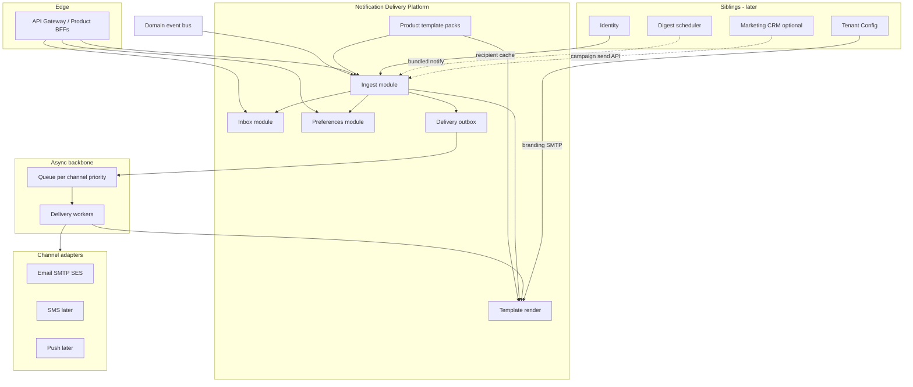
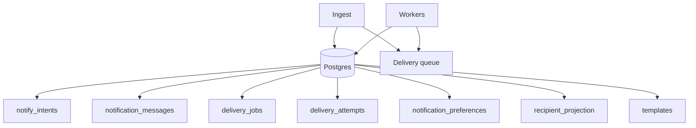
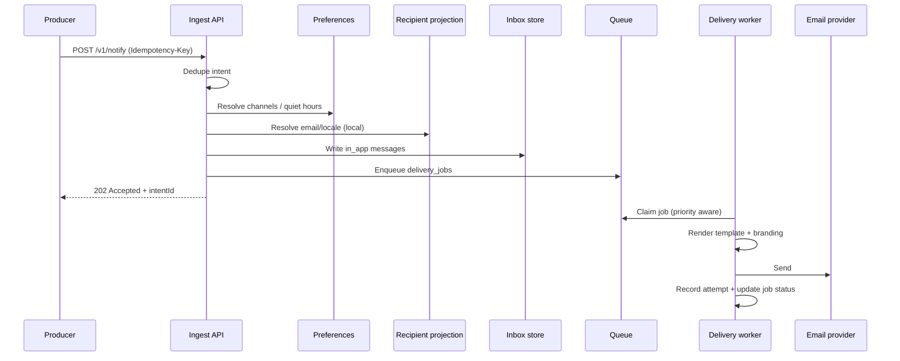

# Notification & Delivery Platform Microservice

**Service name (internal):** Notification & Delivery Platform  
**Audience:** Platform and product teams building any multi-tenant system on the shared stack  
**Status:** Refined target architecture (evaluation + scale design)  
**First consumers:** Mindspark LMS, Life-Coach platform (more products later)  
**Related:** [architecture-microservices.md](./architecture-microservices.md) · [cross-product-common-modules.md](./cross-product-common-modules.md) · [session-class-handling-microservice.md](./session-class-handling-microservice.md) · [architecture-current.md](./architecture-current.md)  
**Design diagrams:** [notification-email-microservice-diagrams.md](./notification-email-microservice-diagrams.md)

---

## 0. Architect evaluation — is this the best approach?

### Verdict

**Yes for the product strategy; not yet for the scale shape.**

A **shared** Notification & Delivery platform across LMS, coaching, events, fitness, and future products is the right approach. Every product needs the same hard problems solved once: transactional email, in-app inbox, idempotency, preferences, quiet hours, tenant branding, delivery audit, and safe handling of secrets in mail.

The earlier single-blob design (one deployable that synchronously resolves recipients, renders templates, writes inbox, and sends email in the request path) is **not** the best long-term scale architecture. Refine it into a **modular platform** with async delivery workers, hybrid persistence, recipient projection, and peelable scale units.

| Keep | Change |
|------|--------|
| Shared service across products | Do not keep heavy delivery on the ingest API thread |
| NotifyIntent + template packs | Split **Ingest**, **Inbox**, **Delivery** modules |
| Templates + branding centralization | Template registry as versioned artifact; render in workers |
| Preferences / categories / opt-out | Typed preference columns + JSONB extension |
| Idempotency on notify | Add delivery-level dedupe `(intent, user, channel)` |
| No secret body logging | Enforce in Delivery module + structured audit only |
| Event-driven bindings | Keep bindings in packs; ingest stays dumb |

### Alternatives considered

| Approach | Verdict |
|----------|---------|
| **SMTP helpers in every product** | Reject — duplicated bugs (token logging, no prefs, no idempotency) |
| **Third-party only (SendGrid/Customer.io) as “the service”** | Reject as sole design — you still need inbox, tenancy, prefs, audit, multi-product templates |
| **One eternal mega-notification service** | Reject at scale — inbox reads vs email bursts vs batch digests contend |
| **Separate email-only + inbox-only services from day 1** | Premature — same transactions and templates early; peel Delivery first |
| **Modular shared platform (this doc)** | **Adopt** — one contract, async workers, peel Delivery when volume demands |

---

## 1. Purpose

This platform is a **shared capability**, not an LMS bell icon and not a coaching alerts tab.

It owns the universal communications loop:

1. Accept a **NotifyIntent** (API or domain event binding).
2. Resolve recipients and channels (preferences, consent, quiet hours).
3. Render from **templates** + tenant branding + locale.
4. Persist **in-app** messages and enqueue **external** deliveries.
5. Deliver email (SMS/push later) with retries, rate limits, and audit.
6. Expose **inbox** and **preferences** APIs for end users.

Any product that needs “tell a user something happened” integrates here instead of embedding `sendMail` and ad-hoc notification rows.

It does **not** own chat bodies, marketing CRM/campaigns, identity master data, or business rules that decide *whether* to notify.

---

## 2. Refined architecture — modular platform that scales



### 2.1 Deployable strategy (critical for scale)

| Phase | Shape | When |
|-------|--------|------|
| **0 — Modular monolith** | Ingest + Inbox + Delivery workers (same repo), shared DB + queue | Now — LMS strangler + coaching |
| **1 — Peel Delivery workers** | Horizontal worker pool; priority queues (`security`, `transactional`, `bulk`) | Email volume or burst after live/payment |
| **2 — Peel Inbox read API** | Read-optimized inbox service + cache for unread counts | High concurrent badge polling |
| **3 — Digest / Campaign siblings** | Scheduled digest bundler; optional CRM calls `/v1/notify` | Weekly digests or marketing at scale |

**Rule:** product BFFs keep stable paths (`/v1/notify`, `/v1/inbox`). Gateway routes unchanged after peels.

### 2.2 Module responsibilities

| Module | Owns | Scale driver |
|--------|------|--------------|
| **Ingest** | Accept intent, idempotency, validate templateKey, expand recipients, apply prefs, write inbox rows, enqueue deliveries | Notify accept QPS |
| **Inbox** | List, unread count, read/read-all, archive | Users × poll frequency |
| **Preferences** | Category/channel toggles, quiet hours, unsubscribe tokens | Low write; cache reads |
| **Template render** | Versioned templates, layout partials, locale, branding merge | CPU during bursts |
| **Delivery workers** | Claim queue jobs, send via adapters, retry/DLQ, audit metadata | Provider rate limits × burst |
| **Recipient projection** | Cached `(userId → email, phone, locale)` from Identity events | Avoid sync Identity on every notify |

### 2.3 What stays outside (siblings)

| Sibling | Role |
|---------|------|
| **Identity** | Source of truth for email, phone, locale, verified flags |
| **Tenant / Config** | Branding, `from`/`replyTo`, per-tenant SMTP/SES config refs |
| **Digest scheduler** | Rolls up N events into one digest intent (calls Ingest) |
| **Marketing CRM** | Audience segmentation, drip logic; uses `/v1/notify` as dumb pipe |
| **Domain producers** | Catalog, Payments, Assessment emit events or call Notify API |

---

## 3. Design principle: platform core + product packs

| Layer | Responsibility |
|-------|----------------|
| **Platform core** | Intent API, inbox, prefs, outbox, workers, adapters, tenancy, idempotency, audit |
| **Product pack** | `templateKey` catalog, categories, default channels, event bindings, retention, deep-link patterns |
| **Product BFF** | UX paths (`/notifications`, `/alerts`), DTO shaping, product deep links |

**Rule:** never fork the service per product. Register `productCode` + template pack.

**BFF (Backend for Frontend):** thin product API in front of the platform. LMS `GET /api/t/:slug/notifications` → `GET /v1/inbox`.

---

## 4. Why a shared notification platform exists

| Domain | Typical intents |
|--------|-----------------|
| LMS | Class invite, schedule created, payment approved, live started, quiz graded |
| Coaching | Session booked/cancelled, reminder, consent update |
| Fitness | Slot reminder, plan renewed, waitlist |
| Events | Registration confirmed, session starting soon |
| Workshops | Enrollment confirmed, materials ready |
| Corporate L&D | Deadline reminder, certificate ready |

Without a shared platform, every product reimplements SMTP, layouts, unread badges, and preference gaps—and repeats security mistakes (logging reset tokens when SMTP is off).

---

## 5. Bounded context and naming

| Platform term | Meaning |
|---------------|---------|
| **NotifyIntent** | Idempotent request: `templateKey` + recipients + data |
| **NotificationMessage** | Durable in-app inbox row for one user |
| **DeliveryJob** | One unit of external send work (user × channel) |
| **DeliveryAttempt** | One try against a provider |
| **Template** | Versioned content for `(productCode, templateKey, channel)` |
| **Category** | Preference bucket: `security`, `transactional`, `reminder`, `digest`, `marketing` |
| **Channel** | `in_app` \| `email` \| `sms` \| `push` |

`productCode` is an open registered string (`lms`, `coaching`, `fitness`, `events`, …).

---

## 6. What this platform owns vs does not own

### Owns

- Notify ingest (sync API + event consumers)
- Template registry and rendering
- In-app inbox and read state
- Channel routing, preferences, quiet hours, unsubscribe
- Delivery outbox, queue, retries, DLQ
- Delivery audit metadata (not message bodies with secrets)
- Per-tenant/product rate limits

### Does not own

| Capability | Owner |
|------------|--------|
| User email/phone/locale (SoT) | Identity |
| Tenant branding, SMTP credential refs | Tenant / Config + secrets store |
| Whether business event occurred | Producer services |
| Chat message bodies | Chat |
| Campaign audience logic | Marketing CRM (optional) |
| Announcement CMS authoring | Product (delivery via notify) |

**Hard rules**

1. Never log raw HTML/text that may contain tokens, passwords, magic links.
2. Never trust body-supplied `tenantId` without gateway claims.
3. No arbitrary caller HTML — templates only (XSS + abuse).
4. Ingest API returns quickly; delivery is always async for external channels.

---

## 7. Persistence — hybrid store (refined)

**Decision:** PostgreSQL with **typed columns for hot paths** + **JSONB `doc` for extension**. Use a **queue** (SQS, Redis Streams, or NATS JetStream) for delivery work—not DB polling alone at scale.



### 7.1 Physical Postgres shape

```sql
CREATE TABLE notify_intents (
  id               text PRIMARY KEY,
  tenant_id        text NOT NULL,
  product_code     text NOT NULL,
  template_key     text NOT NULL,
  category         text NOT NULL,
  idempotency_key  text NOT NULL,
  status           text NOT NULL,
  doc              jsonb NOT NULL,
  created_at       timestamptz NOT NULL,
  UNIQUE (tenant_id, idempotency_key)
);

CREATE TABLE notification_messages (
  id            text PRIMARY KEY,
  tenant_id     text NOT NULL,
  product_code  text NOT NULL,
  user_id       text NOT NULL,
  intent_id     text NOT NULL,
  template_key  text NOT NULL,
  category      text NOT NULL,
  title         text NOT NULL,
  body          text NOT NULL,
  link          text,
  read_at       timestamptz,
  archived_at   timestamptz,
  created_at    timestamptz NOT NULL,
  doc           jsonb NOT NULL
);

CREATE TABLE delivery_jobs (
  id            text PRIMARY KEY,
  tenant_id     text NOT NULL,
  product_code  text NOT NULL,
  intent_id     text NOT NULL,
  user_id       text,
  channel       text NOT NULL,
  priority      smallint NOT NULL DEFAULT 5,
  status        text NOT NULL,
  scheduled_for timestamptz NOT NULL DEFAULT now(),
  dedupe_key    text NOT NULL,
  doc           jsonb NOT NULL,
  created_at    timestamptz NOT NULL,
  UNIQUE (tenant_id, dedupe_key)
);

CREATE TABLE delivery_attempts (
  id            text PRIMARY KEY,
  job_id        text NOT NULL,
  tenant_id     text NOT NULL,
  channel       text NOT NULL,
  status        text NOT NULL,
  provider_id   text,
  error         text,
  attempt_no    int NOT NULL,
  created_at    timestamptz NOT NULL
);

CREATE TABLE notification_preferences (
  tenant_id     text NOT NULL,
  product_code  text NOT NULL,
  user_id       text NOT NULL,
  locale        text,
  doc           jsonb NOT NULL,
  updated_at    timestamptz NOT NULL,
  PRIMARY KEY (tenant_id, product_code, user_id)
);

-- Fed by Identity events; avoids sync RPC on every notify
CREATE TABLE recipient_projection (
  tenant_id     text NOT NULL,
  user_id       text NOT NULL,
  email         text,
  email_verified boolean,
  phone_e164    text,
  locale        text,
  updated_at    timestamptz NOT NULL,
  PRIMARY KEY (tenant_id, user_id)
);

CREATE TABLE templates (
  product_code  text NOT NULL,
  template_key  text NOT NULL,
  channel       text NOT NULL,
  version       int NOT NULL,
  status        text NOT NULL,
  doc           jsonb NOT NULL,
  PRIMARY KEY (product_code, template_key, channel, version)
);
```

**Indexes (scale-critical):**

- messages `(tenant_id, user_id, created_at DESC)`
- messages partial `(tenant_id, user_id) WHERE read_at IS NULL` for unread badge
- jobs `(status, scheduled_for)` where pending
- intents `(tenant_id, created_at DESC)` for support
- attempts `(job_id, attempt_no)`

### 7.2 Store rules

1. Inbox list queries use typed columns (`title`, `body`, `read_at`) — not JSONB scans.
2. Delivery logs store **to, subject, status, provider_id, error** — not full HTML with tokens.
3. Idempotency at intent: `(tenant_id, idempotency_key)`.
4. Dedupe at delivery: `(tenant_id, dedupe_key)` where key = `intentId:userId:channel`.
5. Retention jobs purge old messages/attempts per pack policy.

---

## 8. API surface (stable contract)

Gateway injects `tenantId`, `userId`, capabilities, `productCode`.

### Producer (Ingest)

| Method | Path | Purpose |
|--------|------|---------|
| `POST` | `/v1/notify` | Create intent (idempotent); returns `202 Accepted` |
| `POST` | `/v1/notify/batch` | Bulk intents (max recipients enforced) |
| `GET` | `/v1/intents/{id}` | Intent + delivery summary for support |

### Inbox

| Method | Path | Purpose |
|--------|------|---------|
| `GET` | `/v1/inbox` | List (cursor pagination) |
| `GET` | `/v1/inbox/unread-count` | Badge — cache-friendly |
| `POST` | `/v1/inbox/{id}/read` | Mark read |
| `POST` | `/v1/inbox/read-all` | Mark all read |
| `DELETE` | `/v1/inbox/{id}` | Archive/hide |

### Preferences

| Method | Path | Purpose |
|--------|------|---------|
| `GET` | `/v1/preferences` | Current user |
| `PUT` | `/v1/preferences` | Update |
| `POST` | `/v1/unsubscribe` | Token-based email opt-out |

### Admin / ops

| Method | Path | Purpose |
|--------|------|---------|
| `GET` | `/v1/deliveries` | Search jobs/attempts |
| `POST` | `/v1/templates` | Register template (CI/admin) |
| `POST` | `/v1/deliveries/{id}/retry` | Retry DLQ |

### BFF aliases

| Product | UX path | Platform |
|---------|---------|----------|
| LMS | `GET /api/t/:slug/notifications` | `GET /v1/inbox` |
| Coaching | `GET /alerts` | `GET /v1/inbox` |
| Any | After `SessionScheduled` | Event → Ingest or `POST /v1/notify` |

---

## 9. Processing pipeline (scale path)



### Ingest steps (sync, fast)

1. Validate `templateKey` for `productCode` (pack).
2. Dedupe on `(tenantId, idempotencyKey)` → return existing if replay.
3. Expand recipients; resolve guest emails explicitly passed.
4. Apply preferences; `security` bypasses opt-out.
5. Quiet hours → set `scheduled_for` on email/SMS jobs (in-app immediate unless pack says otherwise).
6. Write inbox rows for `in_app` channel.
7. Insert `delivery_jobs` + publish to queue.
8. Return `202` with `intentId`.

### Worker steps (async)

1. Claim job with visibility timeout / lease.
2. Re-check prefs if job was delayed (user may have opted out).
3. Render template (cached pack + branding).
4. Send via adapter; record `delivery_attempt`.
5. Backoff retry; after N → DLQ + alert.
6. Rate limit per tenant and per provider.

### Priority queues

| Priority | Categories | Example |
|----------|------------|---------|
| 1 (highest) | `security` | Password reset |
| 3 | `transactional` | Payment receipt, invite |
| 5 | `reminder` | Session starting soon |
| 7 | `digest` | Weekly summary |
| 9 (lowest) | `marketing` | Promos |

---

## 10. Templates, branding, categories

### Template model

- Key: `(productCode, templateKey, channel, version)`.
- Safe templating over `data`, `branding`, `user`, `locale`.
- Email: always `text` + `html`. In-app: `title`, `body`, `link`.
- Shared layout partials in platform; packs supply body blocks.
- Templates registered via CI in v1 (not tenant-editable arbitrary HTML).

### Categories and opt-out

| Category | Opt-out | Notes |
|----------|---------|-------|
| `security` | Never | Reset, MFA, magic link |
| `transactional` | Usually never | Receipts, invites |
| `reminder` | Email/SMS yes | In-app optional |
| `digest` | Yes | Often opt-in |
| `marketing` | Yes | Opt-in preferred |

### Branding (from Tenant/Config, cached)

Display name, logo, colors, `from`, `replyTo`, deep-link origin. Join `deepLinkPath` with allowlisted origin only.

---

## 11. Event-driven integration

Prefer events over scattered `sendMail` in product code.

| Upstream event | Pack binding |
|----------------|--------------|
| `SessionScheduled` | `session.scheduled` → container participants |
| `SessionStartingSoon` | `session.reminder` |
| `PaymentApproved` | `payment.approved` |
| `MemberInvited` | `class.invite` |
| `UserPasswordResetRequested` | `auth.password_reset` |

Pack bindings: `eventType` → `templateKey` + recipient strategy (`actor`, `explicit_ids`, `container_participants` via event payload refs — **not** live Catalog RPC in hot path when possible).

Outbound (ops): `NotificationDelivered`, `NotificationFailed`.

Use **transactional outbox** in producer OR idempotent event consumption with dedupe keys derived from `eventId`.

---

## 12. Channel adapters

| Channel | v1 | Scale notes |
|---------|-----|-------------|
| **in_app** | Yes | Written in Ingest transaction; optional WS ping later |
| **email** | Yes | SMTP/SES; tenant override; skip-safe logging |
| **sms** | Later | Stricter rate limits; E.164 from projection |
| **push** | Later | Device tokens via Identity or thin Device registry |

When transport not configured: job → `skipped`, log reason, **never** log body.

Adapter: `send({ to, subject, text, html, headers }) → { providerId }`.

---

## 13. Authorization

| Capability | Meaning |
|------------|---------|
| `notify.send` | Service-to-service create intent |
| `inbox.read` | Own inbox |
| `prefs.manage` | Own preferences |
| `deliveries.read` | Tenant admin / support logs |
| `templates.manage` | Platform ops |

End users cannot send arbitrary mail through `/v1/notify`. Product “message user” features use constrained templates + rate limits.

---

## 14. State machines

### NotifyIntent

```text
accepted → processing → completed
accepted → processing → partial_failure
* → rejected
```

### DeliveryJob

```text
pending → sending → sent
pending → delayed (quiet hours) → pending → ...
pending → sending → failed → pending (retry)
failed → dead_letter
pending → skipped
```

### NotificationMessage

```text
unread → read
* → archived
```

---

## 15. Scale levers

| Concern | Approach |
|---------|----------|
| Burst after live/payment | Priority queue + horizontal workers |
| Unread badge polling | Redis cache `(tenant, user) → count`; invalidate on read/write |
| Inbox list | Cursor on `(created_at, id)`; typed columns |
| Recipient lookup | `recipient_projection` from Identity events |
| Template CPU | Precompile/cache templates; render in workers only |
| Multi-tenant fairness | Per-tenant rate limits + concurrency caps |
| Provider limits | Exponential backoff; circuit breaker per provider |
| Idempotency | Intent + delivery dedupe keys |
| Cross-product user | Inbox scoped by `(tenant_id, product_code)`; merged feed is BFF concern |
| Digests | Sibling scheduler batches → single `/v1/notify` |

---

## 16. Adopting a new product (runbook)

1. Register `productCode` in Tenant/Config.
2. Add template pack: keys, categories, channels, event bindings, retention.
3. Point BFF inbox at `/v1/inbox`.
4. Replace product SMTP with `/v1/notify` or event bindings.
5. Contract-test templates (snapshot; no token in logs).
6. Configure branding + email for tenants.

Example pack:

```json
{
  "productCode": "lms",
  "defaultChannels": ["in_app", "email"],
  "retentionDays": { "inbox": 180, "deliveryLog": 365 },
  "rateLimits": { "notifyPerMinute": 120, "emailPerTenantPerHour": 5000 },
  "templates": [
    { "key": "session.scheduled", "category": "reminder", "channels": ["in_app", "email"] },
    { "key": "auth.password_reset", "category": "security", "channels": ["email"], "priority": 1 }
  ],
  "eventBindings": [
    { "eventType": "SessionScheduled", "templateKey": "session.scheduled", "recipients": "event.participantUserIds" }
  ]
}
```

---

## 17. Migration approach (LMS strangler)

1. Stand up modular monolith: Ingest + Inbox + workers + queue.
2. Dual-write Prisma `Notification` + `/v1/notify` (or read from service first).
3. Move **inbox read path** first (list, unread, read).
4. Migrate templates one by one: invite, schedule, payment, password-reset, live-start.
5. Retire `email.ts` product functions; keep layout as shared partials.
6. Wire Identity → `recipient_projection`.
7. Onboard coaching with prefs/consent from day one.

---

## 18. Non-functional requirements

| Area | Requirement |
|------|-------------|
| Multi-product | `tenant_id` + `product_code` on all rows |
| Multi-tenancy | Fail closed; no cross-tenant inbox |
| Latency | Ingest p99 low; delivery async |
| Throughput | Queue-backed workers; scale horizontally |
| Idempotency | Required on `/v1/notify` |
| Security | No secret body logs; signed unsubscribe; safe deep links |
| Privacy | Audit metadata only in durable logs |
| Retention | Pack TTL + purge jobs |
| Observability | Metrics: accept rate, queue depth, send latency, DLQ, skip rate |
| Availability | Stateless API; HA Postgres; multi-AZ queue |

---

## 19. Implementation checklist

**Phase 0 — Modular monolith MVP**

- [ ] `POST /v1/notify` + idempotency + `202 Accepted`
- [ ] Hybrid tables + delivery queue
- [ ] Inbox APIs + unread count
- [ ] Email adapter (skip-safe logging)
- [ ] Template registry + layout partials
- [ ] Delivery workers + retry + DLQ
- [ ] Preferences + quiet hours + security bypass
- [ ] `recipient_projection` consumer
- [ ] Product pack loader (`lms` first)
- [ ] Priority queues for security/transactional
- [ ] OpenAPI + template contract tests

**First pack: `lms`**

- [ ] Port invite, schedule, payment, password-reset, live-start templates
- [ ] BFF aliases for notification routes

**Second pack: `coaching`**

- [ ] Reminder templates, consent defaults, no private notes in email review

**Phase 1+**

- [ ] Redis unread cache
- [ ] Peel Delivery worker pool
- [ ] SMS / push adapters
- [ ] Digest scheduler sibling
- [ ] Realtime inbox invalidation (WS/SSE)
- [ ] Multi-provider email failover

**Non-goals for v1**

- Full marketing automation / CRM
- Chat replacement
- Arbitrary caller HTML
- Sync email send in API request path

---

## 20. Decision summary

| Decision | Choice | Rationale |
|----------|--------|-----------|
| Shared vs per-product | **Shared platform** | One inbox + email + prefs + audit |
| Scale shape | **Modular → async Delivery** | Ingest vs burst send vs inbox reads differ |
| Ingest | API + event bindings | Decouple producers from SMTP |
| Delivery | Queue + workers | Handle live/payment bursts |
| Content | Versioned templates + branding | Safe, consistent, localizable |
| Channels | In-app + email first | Matches LMS; extend later |
| Data | Hybrid typed + JSONB | Scale inbox queries |
| Recipients | Local projection | Avoid Identity RPC per notify |
| Safety | No secret logs; mandatory security | LMS hardening preserved |
| Digests / campaigns | Sibling callers | Keep core dumb pipe |

---

## 21. Open questions

1. Announcements/notices: first-class here or product CMS + deliver via notify? **Recommend:** product owns content; platform delivers.
2. Device push tokens: Identity vs Notification? **Recommend:** Identity owns tokens; notify reads projection.
3. Per-tenant SMTP vs platform SES default? **Recommend:** platform SES default; tenant override for enterprise.
4. Cross-product merged inbox for one user? **Recommend:** per-tenant/product inbox; BFF merges if needed.
5. Template tenant overlays in v2? **Recommend:** CI-only v1; controlled overlay later with sanitization.

Record answers as ADRs beside this file.
