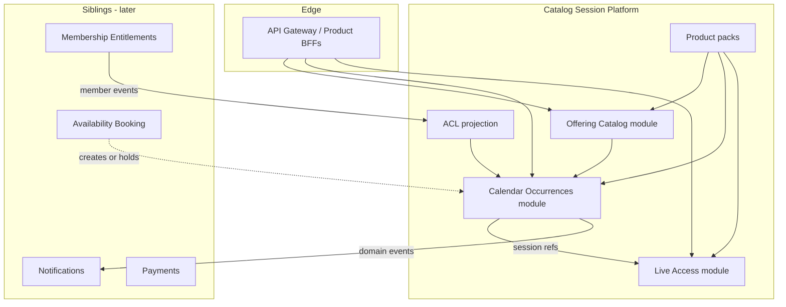
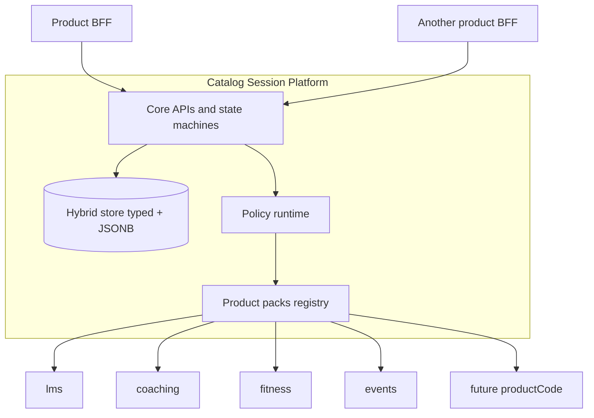
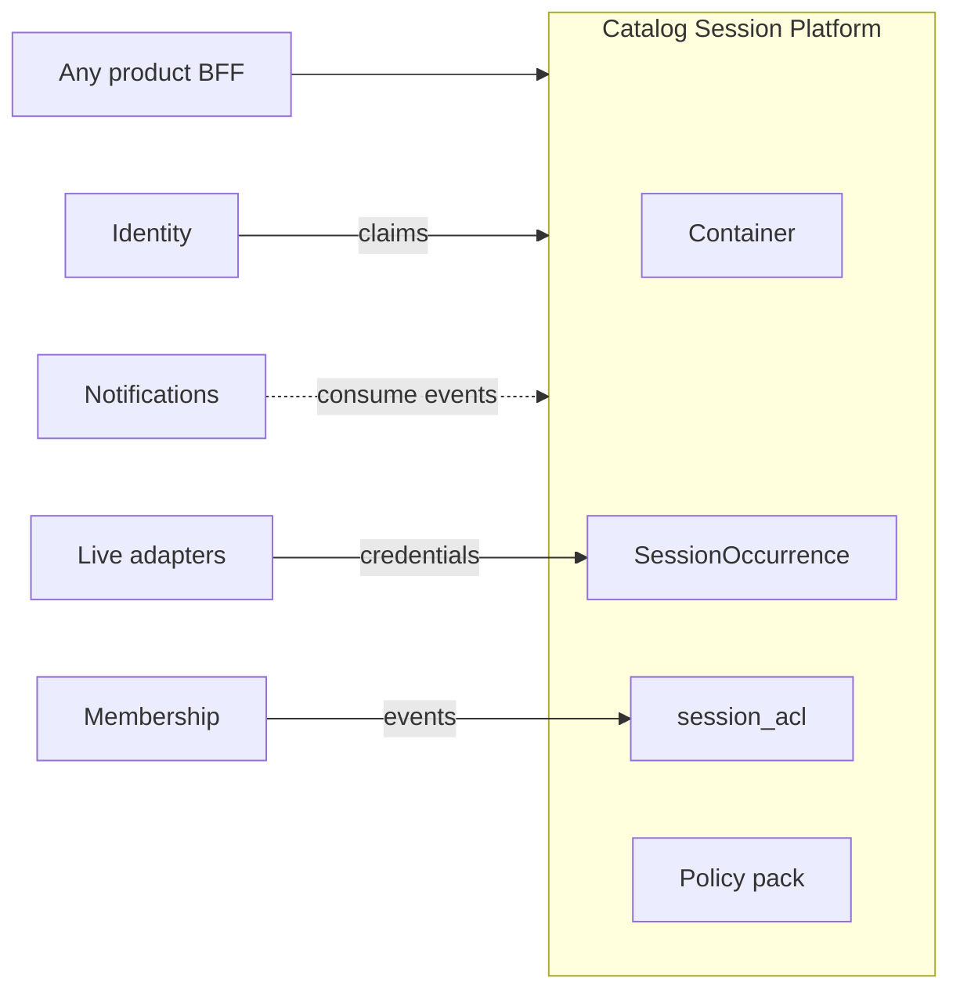
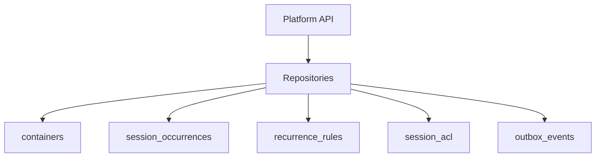
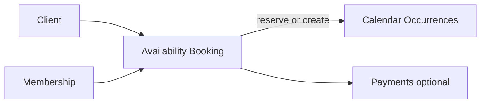

# Catalog & Session Platform Microservice

**Service name (internal):** Catalog & Session Platform  
**Audience:** Platform and product teams building any multi-tenant system on the shared stack  
**Status:** Refined target architecture (evaluation + scale design)  
**First consumers:** Mindspark LMS, Life-Coach platform (more products later)  
**Related:** [architecture-microservices.md](./architecture-microservices.md) · [cross-product-common-modules.md](./cross-product-common-modules.md) · [notification-email-microservice.md](./notification-email-microservice.md) · [architecture-current.md](./architecture-current.md)

---

## 0. Architect evaluation — is this the best approach?

### Verdict

**Yes for the product strategy; not yet for the scale shape.**

A **shared** Catalog & Session platform for classes, programs, events, workshops, and appointments is the right approach across multiple systems. Forking a private “class service” per product will cost more and diverge on security (meeting URLs, tenancy, join gates).

The earlier single-blob design (one deployable owning catalog CRUD, agendas, membership checks, live join, and eventually booking) is **not** the best long-term scale architecture. Refine it into a **modular platform** with peelable scale units, hybrid persistence, and an ACL projection for member agendas.

| Keep | Change |
|------|--------|
| Shared service across products | Do not keep Live Access forever colocated with catalog writes |
| Container + SessionOccurrence | Add first-class `offeringKind` beside `productCode` |
| Policy packs + BFF aliases | Keep packs thin; move booking/availability out when needed |
| Membership owned elsewhere | Add local `session_acl` projection for scalable filters |
| Postgres + JSONB metadata | Hybrid: typed core columns for hot paths, JSONB for extension |
| Meeting privacy via `/join` | Scale `/join` as its own module/service under burst |

### Alternatives considered

| Approach | Verdict |
|----------|---------|
| **Copy class/session per product** | Reject — duplicated privacy bugs, recurrence, tenancy |
| **One eternal mega-service** | Reject at scale — live spikes vs catalog CRUD contend |
| **Only generic “Event” with no Container** | Reject — loses offering ownership, catalog, membership anchor |
| **Fully separate Catalog vs Calendar from day 1** | Premature — same team, same transactions early; split when profiles diverge |
| **Modular shared platform (this doc)** | **Adopt** — one contract, peel Live Access / Booking later |

---

## 1. Purpose

This microservice family is a **shared platform capability**, not an LMS feature and not a coaching feature.

It owns two universal aggregates:

1. **Container (Offering)** — a long-lived catalog offering people belong to (class, program, cohort, workshop series, event series, fitness plan, clinic track, …).
2. **SessionOccurrence** — a timed occurrence under a container (live class, appointment, workshop slot, webinar, group call, …).

Any future product that needs “create an offering → schedule occurrences → list/filter by role → start/join/end a meeting” should integrate this platform instead of inventing a private class/session stack.

Core operational loop (same for every product):

1. Create a durable container (`offeringKind` + `productCode`).
2. Create one or many session occurrences (single or recurring rule).
3. List and filter containers and sessions by ownership, membership ACL, status, and time.
4. Authorize manage vs view vs join.
5. Emit domain events for Notifications, Payments, Attendance, Notes, Search, and Live adapters.

It does **not** own payments, content libraries, quizzes, AI, chat bodies, clinical/private notes, or (in the refined target) full marketplace booking engines.

---

## 2. Refined architecture — modular platform that scales



### 2.1 Deployable strategy (critical for scale)

| Phase | Shape | When |
|-------|--------|------|
| **0 — Modular monolith** | One deployable, three internal modules, one DB | Now — LMS strangler + coaching |
| **1 — Peel Live Access** | Separate service for start/join/end + providers | Concurrent join QPS or SFU fan-out dominates |
| **2 — Availability / Booking** | Sibling service | Client self-booking, holds, waitlists, capacity markets |
| **3 — Split Catalog vs Calendar DBs** | Only if needed | Catalog write profile ≪ agenda read profile and ops pain is real |

**Rule:** product BFFs always call the same `/v1/containers`, `/v1/sessions`, `/v1/sessions/{id}/join` contracts. Gateway routes `/join` to Live Access after the peel — no product rewrite.

### 2.2 Module responsibilities

| Module | Owns | Scale driver |
|--------|------|--------------|
| **Offering Catalog** | Container CRUD, publish/archive, facilitator, visibility, tags | Tenants × catalog size |
| **Calendar / Occurrences** | Schedule, recurrence, reschedule, cancel, agendas, status (scheduled/cancelled/…) | Time-range queries × ACL |
| **Live Access** | start / join / end, provider adapters, short-lived credentials, URL privacy enforcement | Concurrent live rooms |
| **ACL projection** | Local allow-list `(tenant, user, container)` for agenda filters | Membership churn |

### 2.3 Taxonomy: `productCode` + `offeringKind`

`productCode` answers *which product system* (`lms`, `coaching`, `fitness`, `events`).  
`offeringKind` answers *what shape of offering* inside that product:

| offeringKind | Typical use |
|--------------|-------------|
| `class` | LMS ongoing class |
| `program` | Coaching / L&D program |
| `workshop` | Short series or single workshop container |
| `event_series` | Conference track / meetup series |
| `appointment_book` | 1:1 coaching/clinic bookable container |
| `plan` | Fitness plan / cohort |

A single product (e.g. LMS) may later host both `class` and `workshop` without a new microservice.

---

## 3. Design principle: platform core + product packs



| Layer | Responsibility |
|-------|----------------|
| **Platform core** | Aggregates, APIs, indexes, ACL projection, status machines, meeting privacy, outbox events, tenancy |
| **Product pack** | Nouns, allowed `offeringKind`s, statuses, recurrence limits, join window, visibility defaults, role→capability map |
| **Product BFF** | Path aliases (`/classes`, `/programs`, `/workshops`), UX DTOs, product-only validation |

**Rule:** never fork the service per product. Register a new `productCode` + pack when a new product adopts the platform. Keep packs **policy**, not a second codebase.

---

## 4. Why “Container” exists (universal)

In everyday speech, **session** almost always means the timed meeting → **SessionOccurrence**.

**Container** is the parent offering that outlives any one meeting:

| Domain example | Container | SessionOccurrence |
|----------------|-----------|-------------------|
| LMS | Class “Grade 10 Maths” | Tuesday 10:00 live class |
| Coaching | Program / cohort | Client appointment |
| Fitness | Training plan / group | Workout class slot |
| Events | Conference track / meetup series | Talk at 14:00 |
| Workshops | Workshop series | Day-1 lab slot |
| Corporate L&D | Course offering | Instructor-led webinar |
| Clinic / wellness | Care pathway / group | Visit / consult slot |

Without Container you either duplicate offering metadata onto every session, or invent a different parent type in every product.

---

## 5. Problem statement (first consumers + future)

### Pattern every product shares

- Multi-tenant isolation
- Staff facilitator vs participant visibility
- Recurring or one-off timed meetings
- Private meeting credentials (no raw URLs in list APIs)
- Filters by time window, status, facilitator, member

### LMS today (first strangler source)

Monolith evidence: `classes.ts`, `schedules.ts`, `live.ts`, `classAccess.ts`, `Class` + `ClassSchedule`.

Must preserve: owner/admin/member list rules, recurrence cap, external URL privacy, just-in-time join.

### Coaching (second consumer)

Programs/appointments, cancellation/no-show, optional client booking (via **Booking sibling** when ready), stricter privacy for notes (notes stay outside this service).

### Future products

Fitness, events, workshops, corporate training, clinics — plug in via `productCode` + `offeringKind` + policy pack + BFF aliases.

---

## 6. Bounded context and naming

| Platform term | Meaning | Example aliases |
|---------------|---------|-----------------|
| **Container** | Long-lived offering | class, program, cohort, workshop series, track, plan |
| **SessionOccurrence** | Timed meeting | live session, appointment, slot, webinar, consult |
| **Facilitator** | Primary staff owner | teacher, coach, trainer, host, clinician |
| **Participant** | Member allowed to view/join | student, client, athlete, attendee |
| **Membership** | Access grant (external SoT) | enrollment, relationship, registration |
| **ACL row** | Local projection of membership for queries | `(userId, containerId)` allow |



---

## 7. What this platform owns vs does not own

### Owns

- Container lifecycle (create, update, publish/archive)
- Session lifecycle (create, recurrence rules, materialization window, update, cancel)
- Live session transitions (start/end) and join credential issuance (Live Access module)
- List/filter indexes, ACL projection, agendas
- Facilitator assignment
- Meeting metadata needed for join (platform, room key, external URL presence, recording pointer)
- Authz for manage/view/join via packs + ACL
- Domain events (transactional outbox)

### Does not own

| Capability | Owner |
|------------|--------|
| Identity, passwords, global roles | Identity |
| Tenant branding, plans, registered productCodes | Tenant / Config |
| Payments, invoices | Payments |
| Who is a member (source of truth) | Membership / product enrollment |
| Learning content, quizzes | Product content / assessment |
| Rich notes / clinical records | Product notes |
| Actual SFU (Jitsi/Zoom/Teams) | Live meeting **adapter** (called by Live Access) |
| Chat bodies | Chat |
| Availability search, holds, waitlists | **Availability / Booking** sibling |

---

## 8. Persistence — hybrid store (refined)

**Decision:** PostgreSQL with **typed core columns for hot filters** + **JSONB `doc` for extension**. Do not rely on JSONB alone for agenda/ACL queries at scale.



### 8.1 Example documents (logical)

**Container**

```json
{
  "_id": "ctr_01H...",
  "tenantId": "ten_...",
  "productCode": "lms",
  "offeringKind": "class",
  "schemaVersion": 1,
  "title": "Grade 10 Mathematics",
  "description": "...",
  "status": "published",
  "facilitatorUserId": "usr_...",
  "visibility": "private_members",
  "capacity": null,
  "timezone": "Asia/Colombo",
  "tags": ["grade-10", "math"],
  "metadata": { "batchId": "bat_...", "priceHint": 5000 },
  "createdAt": "2026-08-20T10:00:00.000Z",
  "updatedAt": "2026-08-20T10:00:00.000Z"
}
```

**SessionOccurrence**

```json
{
  "_id": "ses_01H...",
  "tenantId": "ten_...",
  "productCode": "lms",
  "offeringKind": "class",
  "schemaVersion": 1,
  "containerId": "ctr_01H...",
  "startsAt": "2026-08-21T04:30:00.000Z",
  "endsAt": "2026-08-21T06:00:00.000Z",
  "status": "scheduled",
  "meeting": {
    "platform": "jitsi",
    "roomKey": null,
    "hasExternalLink": true,
    "externalMeetingUrl": "https://zoom.us/j/...",
    "recordingUrl": null
  },
  "recurrenceRuleId": "rr_01H...",
  "metadata": {},
  "rowVersion": 1,
  "createdAt": "2026-08-20T10:05:00.000Z",
  "updatedAt": "2026-08-20T10:05:00.000Z"
}
```

### 8.2 Physical Postgres shape

```sql
CREATE TABLE containers (
  id                  text PRIMARY KEY,
  tenant_id           text NOT NULL,
  product_code        text NOT NULL,
  offering_kind       text NOT NULL,
  status              text NOT NULL,
  facilitator_user_id text NOT NULL,
  visibility          text NOT NULL,
  doc                 jsonb NOT NULL,
  created_at          timestamptz NOT NULL,
  updated_at          timestamptz NOT NULL
);

CREATE TABLE recurrence_rules (
  id              text PRIMARY KEY,
  tenant_id       text NOT NULL,
  container_id    text NOT NULL,
  rrule           text NOT NULL,
  timezone        text NOT NULL,
  until_at        timestamptz,
  materialized_through timestamptz,
  doc             jsonb NOT NULL
);

CREATE TABLE session_occurrences (
  id                  text PRIMARY KEY,
  tenant_id           text NOT NULL,
  product_code        text NOT NULL,
  offering_kind       text NOT NULL,
  container_id        text NOT NULL,
  status              text NOT NULL,
  starts_at           timestamptz NOT NULL,
  ends_at             timestamptz,
  facilitator_user_id text,
  recurrence_rule_id  text,
  row_version         int NOT NULL DEFAULT 1,
  doc                 jsonb NOT NULL,
  created_at          timestamptz NOT NULL,
  updated_at          timestamptz NOT NULL
);

-- Local projection for "my agenda" / member filters (fed by Membership events)
CREATE TABLE session_acl (
  tenant_id     text NOT NULL,
  product_code  text NOT NULL,
  container_id  text NOT NULL,
  user_id       text NOT NULL,
  capability    text NOT NULL DEFAULT 'session.view',
  updated_at    timestamptz NOT NULL,
  PRIMARY KEY (tenant_id, container_id, user_id, capability)
);
```

**Indexes (scale-critical):**

- containers `(tenant_id, product_code, status)`, `(tenant_id, facilitator_user_id)`, `(tenant_id, offering_kind, status)`
- sessions `(tenant_id, starts_at)`, `(tenant_id, container_id, starts_at)`, `(tenant_id, status, starts_at)`
- ACL `(tenant_id, user_id, container_id)`
- Partial unique where useful (e.g. one live session per container if pack requires)

### 8.3 Recurrence at scale (refined)

Do **not** only “expand 52 rows and forget.”

1. Persist a **recurrence rule** (`rrule` + timezone + until).
2. **Materialize a forward window** (e.g. next 90 days) into `session_occurrences`.
3. Background job extends `materialized_through` as time advances.
4. Exceptions (single cancel/reschedule) are occurrence rows with override flags in `doc`.

This caps write amplification and keeps agenda indexes bounded.

### 8.4 Document / store rules

1. Container and SessionOccurrence are separate rows (never unbounded arrays in one doc).
2. Every query includes `tenant_id` (and usually `product_code`).
3. Strip `meeting.externalMeetingUrl` from participant list DTOs.
4. Use `row_version` / optimistic lock on reschedule to avoid lost updates.
5. Prefer ACL joins for `participantUserId` agendas — do not call Membership synchronously on every list.

---

## 9. API surface (stable contract)

Gateway injects `tenantId`, `userId`, capabilities, `productCode`.

### Containers

| Method | Path | Purpose |
|--------|------|---------|
| `POST` | `/v1/containers` | Create |
| `GET` | `/v1/containers` | List/filter |
| `GET` | `/v1/containers/{id}` | Detail |
| `PATCH` | `/v1/containers/{id}` | Update |
| `POST` | `/v1/containers/{id}/publish` | Publish |
| `POST` | `/v1/containers/{id}/archive` | Archive |

### Sessions (Calendar)

| Method | Path | Purpose |
|--------|------|---------|
| `POST` | `/v1/containers/{id}/sessions` | Create one or attach recurrence |
| `GET` | `/v1/containers/{id}/sessions` | List for container |
| `GET` | `/v1/sessions` | Cross-container agendas (**requires `from`/`to`**) |
| `GET` | `/v1/sessions/{id}` | Detail (privacy-aware) |
| `PATCH` | `/v1/sessions/{id}` | Reschedule / meeting meta |
| `POST` | `/v1/sessions/{id}/cancel` | Cancel |

### Live Access (same paths; may route to peeled service)

| Method | Path | Purpose |
|--------|------|---------|
| `POST` | `/v1/sessions/{id}/start` | Facilitator start |
| `POST` | `/v1/sessions/{id}/end` | Facilitator end |
| `POST` | `/v1/sessions/{id}/join` | Authorized join credentials |

### Product BFF aliases

| Product | UX path | Platform |
|---------|---------|----------|
| LMS | `GET /api/t/:slug/classes` | `GET /v1/containers?productCode=lms&offeringKind=class` |
| LMS | `POST .../schedules` | `POST /v1/containers/{id}/sessions` |
| Coaching | `GET /programs` | `GET /v1/containers?productCode=coaching&offeringKind=program` |
| Events | `GET /series` | `GET /v1/containers?productCode=events&offeringKind=event_series` |
| Workshops | `GET /workshops` | `GET /v1/containers?offeringKind=workshop` |

---

## 10. Create and list flows

### Create container

1. Take `tenantId` / `productCode` from gateway (never trust body tenant).
2. Load pack; validate `offeringKind` allowed for that product.
3. Validate facilitator via Identity / pack rules.
4. Persist; emit `ContainerCreated`.

### Create session(s)

1. Require `session.manage` on parent container.
2. Normalize UTC `startsAt` / `endsAt`.
3. If recurring: write `recurrence_rules` + materialize forward window (pack `recurrenceMax` / window days).
4. Validate external URLs (HTTPS allowlist); keep URL private in storage.
5. Emit `SessionScheduled` (batch-safe for materialization).

### List sessions (scale path)

1. Require `from` / `to` (max window enforced, e.g. 31–93 days).
2. If `participantUserId=me`: filter via `session_acl` join, not live Membership RPC.
3. Cursor pagination on `(starts_at, id)`.
4. Privacy serializer strips secrets for non-managers.

### Join (Live Access)

1. Check `session.join` + join window (pack).
2. Issue short-lived provider credentials or redirect token.
3. Never return raw external URLs on list endpoints.
4. Cache session+authz briefly in Redis under burst (invalidate on cancel/end).

---

## 11. Authorization

Capabilities (not product role enums):

| Capability | Meaning |
|------------|---------|
| `container.create` | create offering |
| `container.manage` | edit/archive/assign facilitator |
| `container.view` | see container |
| `session.manage` | create/reschedule/cancel/start/end |
| `session.view` | list/detail |
| `session.join` | meeting credentials |

Packs map product roles → capabilities. ACL rows grant `session.view` / `session.join` for participants.

Tolerate Membership lag: show clear `403` / “enrollment syncing” rather than wrong-wide access. Prefer **fail closed**.

---

## 12. State machines

### Container

`draft → published → archived` (optional unpublish if pack allows)

### Session (Calendar)

```text
scheduled → cancelled
scheduled → live        # via Live Access start
live → ended
live → no_show          # if pack enables
scheduled → no_show     # if pack enables
```

Unknown transitions for a pack’s allowed set → `409 Conflict`.

---

## 13. Integration events

| Event | Consumers |
|-------|-----------|
| `ContainerCreated` / `Updated` / `Published` | Search, BFFs, Notifications |
| `SessionScheduled` / `Rescheduled` / `Cancelled` | Notifications, calendar sync, Billing policies |
| `SessionStarted` / `Ended` | Push “join now”, Attendance, Insights, recording jobs |
| `SessionJoinRequested` | Audit |
| `AclEntryUpserted` / `AclEntryRemoved` | Internal projection audit |

Payload minimum: `eventId`, `tenantId`, `productCode`, `offeringKind`, `containerId`, `sessionId?`, `occurredAt`, actor, status, `startsAt?`.

Use a **transactional outbox** in the same DB transaction as the write.

---

## 14. Availability & Booking (sibling — explicit non-core)

When coaching/events need self-serve booking:



Booking owns: availability slots, holds, waitlists, conflict checks against facilitator calendars.  
Calendar owns: the resulting SessionOccurrence.  
Do **not** grow packs into a full booking engine inside Catalog/Session.

---

## 15. Adopting a new product (runbook)

1. Register `productCode` in Tenant/Config.
2. Add pack: nouns, allowed `offeringKind`s, statuses, recurrence window, join window, role→capability map.
3. Point BFF at `/v1/containers` and `/v1/sessions`.
4. Emit membership events → ACL projection.
5. Contract-test the pack; metadata-only fields need no core migration.

Example packs:

```json
{
  "productCode": "lms",
  "allowedOfferingKinds": ["class", "workshop"],
  "containerNoun": "class",
  "sessionNoun": "live session",
  "materializeDays": 90,
  "recurrenceMaxOccurrences": 52,
  "allowParticipantCreateSession": false,
  "defaultVisibility": "private_members",
  "joinWindowMinutesBefore": null,
  "statuses": ["scheduled", "live", "ended", "cancelled"]
}
```

```json
{
  "productCode": "coaching",
  "allowedOfferingKinds": ["program", "appointment_book"],
  "containerNoun": "program",
  "sessionNoun": "session",
  "materializeDays": 60,
  "allowParticipantCreateSession": false,
  "bookingViaSibling": true,
  "defaultVisibility": "private_members",
  "joinWindowMinutesBefore": 15,
  "statuses": ["scheduled", "live", "ended", "cancelled", "no_show"]
}
```

```json
{
  "productCode": "events",
  "allowedOfferingKinds": ["event_series", "workshop"],
  "containerNoun": "series",
  "sessionNoun": "event",
  "materializeDays": 120,
  "defaultVisibility": "public_catalog",
  "joinWindowMinutesBefore": 30,
  "statuses": ["scheduled", "live", "ended", "cancelled"]
}
```

---

## 16. Migration approach (LMS strangler)

1. Stand up hybrid tables + ACL + outbox inside modular monolith.
2. Dual-write or replicate from LMS class/schedule routes.
3. Move **list/filter reads** first (including ACL-backed member lists).
4. Move session write / cancel; then start/join/end (Live Access module).
5. Move container CRUD when membership→ACL pipeline is stable.
6. Keep LMS Prisma as anti-corruption until cutover.
7. Onboard coaching via packs; add Booking sibling only when self-serve scheduling is required.
8. Peel Live Access when metrics justify it.

---

## 17. Non-functional requirements (scale)

| Area | Requirement |
|------|-------------|
| Multi-product | `tenant_id` + `product_code` (+ `offering_kind`) on rows |
| Multi-tenancy | Fail closed; optional Postgres RLS later |
| Agenda performance | Required `from`/`to`; ACL join; cursor pagination |
| Live performance | Redis cache for hot join authz; horizontal Live Access workers |
| Recurrence | Rule + forward materialization; not unbounded eager expand only |
| Idempotency | `Idempotency-Key` on creates |
| Concurrency | `row_version` on occurrence updates |
| Security | Secrets only via `/join`; HTTPS allowlist; no URL leakage in lists |
| Evolution | `schemaVersion` + additive JSON metadata; versioned packs |
| Observability | Latency/error by module; queue depth; materialization lag |
| Availability | Stateless app tier; Postgres HA; outbox publisher |

---

## 18. Implementation checklist

**Phase 0 — Modular monolith MVP**

- [ ] Hybrid `containers` + `session_occurrences` + `recurrence_rules`
- [ ] `session_acl` consumer from Membership events
- [ ] Packs with `allowedOfferingKinds`
- [ ] CRUD + agenda APIs with mandatory time window
- [ ] Privacy-safe serializers + `/join` in Live Access module
- [ ] Transactional outbox
- [ ] OpenAPI + pack contract tests
- [ ] Optimistic locking on reschedule

**First pack: `lms`**

- [ ] Capability map matching `assertCanManageClass`
- [ ] BFF aliases for classes/schedules/live

**Second pack: `coaching`**

- [ ] `no_show`, join window; booking flagged to sibling

**Phase 1+**

- [ ] Peel Live Access deployable
- [ ] Availability/Booking sibling
- [ ] Redis join cache
- [ ] Optional search index for public catalogs

**Non-goals for v1**

- Owning payments or membership writes
- Storing product-private notes
- Replacing Zoom/Jitsi themselves
- Full booking/waitlist engine inside this service

---

## 19. Decision summary

| Decision | Choice | Rationale |
|----------|--------|-----------|
| Shared vs per-product | **Shared platform** | Avoid N clones; consistent privacy/tenancy |
| Scale shape | **Modular → peel Live Access** | Different QPS profiles |
| Naming | Container + SessionOccurrence | Universal across class/program/event/workshop |
| Taxonomy | `productCode` + `offeringKind` | Product system ≠ offering shape |
| Variability | Policy packs + BFF | Extend without forking |
| Data store | Hybrid typed + JSONB | Scale filters + flexible metadata |
| Member agendas | `session_acl` projection | Avoid sync Membership on every list |
| Recurrence | Rule + forward materialization | Bound storage and index growth |
| Booking | Sibling service | Keep calendar core stable |
| Meeting privacy | Private URL + `/join` | Required across verticals |

---

## 20. Open questions (remaining)

1. Ad-hoc 1:1 with no real program — synthetic personal container vs `offeringKind=appointment_book` only?
2. Attendance: platform sibling vs product-owned? (Recommend sibling later; not inside Live Access.)
3. Shared DB per env vs DB-per-product with one codebase? (Recommend shared DB + `product_code` until compliance forces split.)
4. Pack distribution: code modules with CI registration (recommended v1) vs runtime Config service?
5. Public marketplace discovery — OpenSearch beside Catalog, or filters only?

Record answers as ADRs beside this file.
